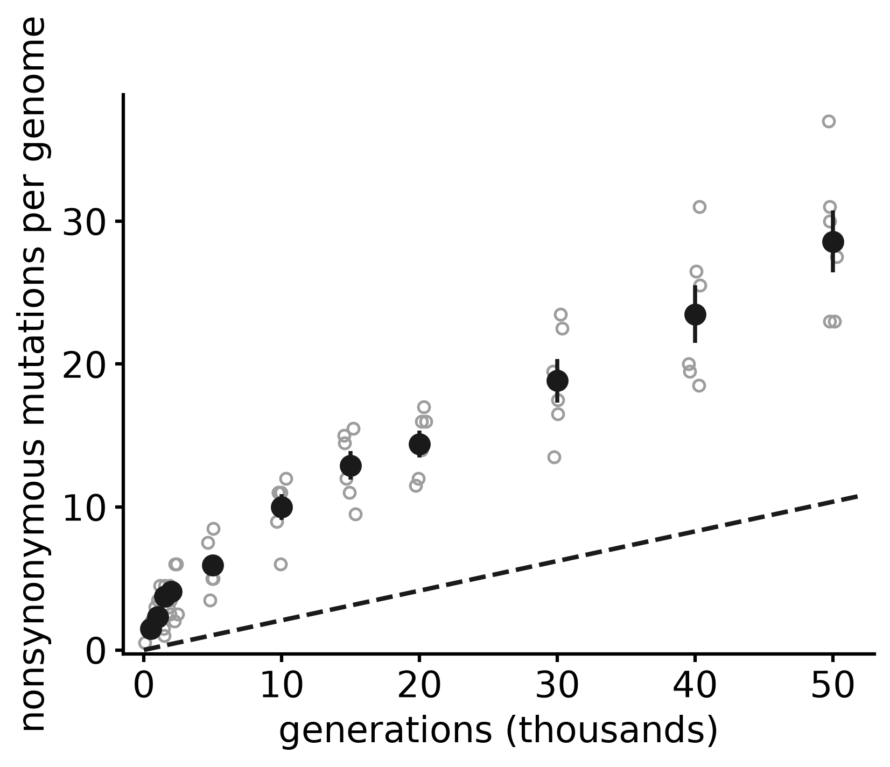
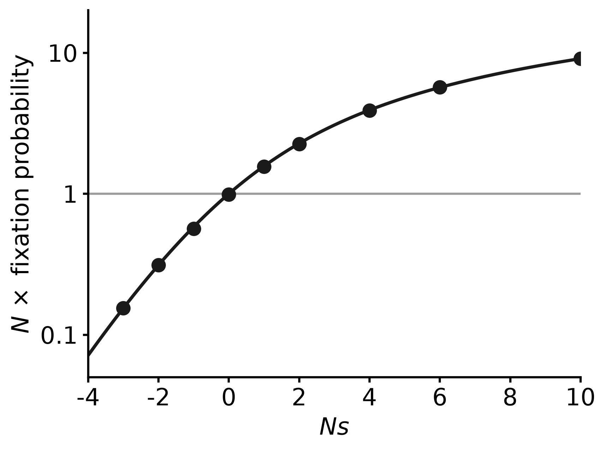

# Lecture 10. Selection, drift and adaptation

Slides: [pdf](https://www.dropbox.com/scl/fi/ju00peel6pybn8rl7pmw0/L10.pdf?rlkey=z9db7g1sjpzar32inksgzvus6&dl=1) · [keynote](https://www.dropbox.com/scl/fi/9wacfyxvdk5lkzyfuizay/L10.key?rlkey=3edrvnnic68q5boyvzyerlc9j&dl=1) · [powerpoint](https://www.dropbox.com/scl/fi/ulf7uf72nvuafxd4joug8/L10.pptx?rlkey=kk03p7k3fm6fijqw102zxoz6h&dl=1)

---

In [L9](l9.html) every mutation was neutral, and the synonymous mutations of the LTEE accumulated at a constant rate, the mutation rate. Mutations that change a protein do not, and in the whole population mutations rise and fall, and some sweep to fixation. How likely is a mutation to fix? We compute the fixation probability, first without selection and then with it, and test it on the LTEE. The test fails in an instructive way: in a large population, beneficial mutations interfere with each other.

## Mutations in the LTEE

In the LTEE of [L9](l9.html#long-term-evolution-experiment) the number of synonymous mutations grows linearly. Nonsynonymous mutations are many more, about 29 at 50,000 generations, and their number grows fast at first and then slows down. If they were neutral too, they would accumulate at a rate set by the fraction of all mutations that are nonsynonymous. Tenaillon et al. compared the LTEE with *mutation-accumulation lines* of the same strain: populations kept through bottlenecks so severe that selection is minimal and almost every mutation stays. They carry 2.9 nonsynonymous mutations per synonymous one. In the LTEE there are 10 times more nonsynonymous mutations than this neutral expectation at 2,000 generations, and 3 times more at 50,000.

> [!figure] Nonsynonymous mutations in the LTEE
> Nonsynonymous mutations per genome, same populations and symbols as the synonymous figure. Dashed line: what neutral nonsynonymous mutations would give, the synonymous line times 2.9, the ratio nonsynonymous/synonymous in the mutation-accumulation lines.
>
> 

Why more? A nonsynonymous mutation changes a protein, and can change the fitness of its carrier. A mutation that raises fitness spreads, and the more it spreads, the more likely we are to find it in the genome we sample.

[Good et al. 2017](https://doi.org/10.1038/nature24287) sequenced the whole of each LTEE population every 500 generations, up to 60,000, and followed the frequency of every mutation that reached about 10%. The sum of the frequencies of all the mutations of a population, $M(t)$, is the number of mutations that a genome carries on average (their Fig. 2b). In the six populations that kept the ancestral mutation rate, $M(t)$ grows by about 20 mutations in the first 10,000 generations and by 10 in the last 10,000 (their Fig. 2c): $2\times10^{-3}$ per generation, then $10^{-3}$. In the other six a mutation in DNA repair raised the mutation rate about a hundred times, and $M(t)$ reaches thousands.

Their Fig. 1 shows the frequency of every mutation, population by population. Mutations rise and fall. Some sweep: they rise quickly, all the way to fixation. Often several rise together, in *cohorts*.

How often does a mutation sweep? We need the probability that a new mutation spreads to the whole population, first without selection and then with it.

## Selection and drift

### Fixation of a neutral mutation

Without mutation, drift in the end leaves a single type ([L9](l9.html#moran-model)). Which one? Let $\Pi(n)$ be the probability that $A$ eventually makes up the whole population (*fixation*), starting from $n$ individuals of type $A$.

**First-event argument**, as for the [extinction probability](l2.html#extinction-probability) of L2. In the Moran model the first change of $n$ is to $n+1$ or to $n-1$, with equal probability:

$$
\Pi(n)=\tfrac12\,\Pi(n+1)+\tfrac12\,\Pi(n-1),\qquad \Pi(0)=0,\quad \Pi(N)=1 .
$$

Then $\Pi(n+1)-\Pi(n)=\Pi(n)-\Pi(n-1)=c$, so $\Pi(n)=c\,n$, and $\Pi(N)=1$ gives

$$
\boxed{\ \Pi(n)=\frac nN\ }
$$

There is a shorter argument. The mean frequency does not change, $\langle x(t)\rangle=x(0)$. At long times $x$ is either 0 or 1, so $\langle x(\infty)\rangle=\Pi$. Both are a statement of symmetry. In the end the whole population descends from a single individual of today, and each individual has the same probability, $1/N$, of being that ancestor.

A new mutation appears in one individual. If it is neutral it fixes with probability $1/N$, and is lost with probability $1-1/N$. Most are lost within a few generations. The few that fix take on average about $N$ generations ([S2](s2.html)).

**In the LTEE.** With $N_e\approx7\times10^7$ ([L9](l9.html#diversity-in-the-ltee)), a new neutral mutation fixes with probability $1/N\approx1.4\times10^{-8}$. The same argument, with the absorbing wall at $Nx$ copies instead of $N$, says that it reaches frequency $x$ with probability $1/(Nx)$: $1.4\times10^{-7}$ for the 10% of Good et al. The few that fix take about $N$ generations, a thousand times the age of the experiment, and reaching 10% takes of the order of $0.1N$. The sweeps of their Fig. 1 take a few thousand generations. They are not drift: every mutation seen there was carried up by selection, its own or that of a mutation on the same genome.

### Moran model with selection

Now $A$ has fitness $f_A=1+s$ and $a$ has $f_a=1$. Each individual reproduces at a rate equal to its fitness, and the offspring replaces an individual chosen at random:

$$
n\to n+1\quad\text{at rate}\quad N f_A\,x(1-x),\qquad n\to n-1\quad\text{at rate}\quad N f_a\,x(1-x).
$$

$s=f_A-f_a$ is the selection coefficient of [L7](l7.html#two-types-growing-exponentially), per generation. For the mean,

$$
\frac{d\langle x\rangle}{dt}=\frac1N\bigl\langle N f_A\,x(1-x)-N f_a\,x(1-x)\bigr\rangle=s\,\langle x(1-x)\rangle .
$$

For $N\to\infty$ the fluctuations vanish, $\langle x(1-x)\rangle\to x(1-x)$, and we get back the replicator L7: $\dot x=s\,x(1-x)$. For finite $N$ the frequency fluctuates around this trend, and can end at 0 even if $s>0$.

### Fixation probability

First-event argument again. Whatever $n$ is, the first change is up with probability $f_A/(f_A+f_a)=r/(1+r)$, with $r=f_A/f_a=1+s$:

$$
\Pi(n)=\frac{r}{1+r}\,\Pi(n+1)+\frac1{1+r}\,\Pi(n-1) .
$$

With $\Delta(n)=\Pi(n)-\Pi(n-1)$ this reads $r\,\Delta(n+1)=\Delta(n)$. The increments form a geometric series, $\Delta(n)=\Delta(1)\,r^{-(n-1)}$. Summing them, $\Pi(n)=\Delta(1)\,(1-r^{-n})/(1-r^{-1})$, and $\Pi(N)=1$ fixes $\Delta(1)$:

$$
\boxed{\ \Pi(n)=\frac{1-r^{-n}}{1-r^{-N}},\qquad r=\frac{f_A}{f_a}\ }
$$

It is the *gambler's ruin*: a random walk that steps up with probability $r/(1+r)$, between two absorbing walls at $0$ and $N$. For $r\to1$ it gives back $n/N$.

For a new mutant, $n=1$, with $|s|\ll1$ and $r^{-N}\simeq e^{-Ns}$:

$$
\Pi(1)=\frac{1-1/r}{1-r^{-N}}\simeq\frac{s}{1-e^{-Ns}} .
$$

What matters is the product $Ns$.

- $Ns\gg1$: $\Pi(1)\simeq s$. A beneficial mutation is lost with probability $1-s$. With $s=1\%$, 99 out of 100 are lost, however large the population.
- $|Ns|\ll1$: $\Pi(1)\simeq(1+Ns/2)/N\simeq1/N$. Selection is invisible, and the mutation behaves as neutral.
- $Ns\ll-1$: $\Pi(1)\simeq|s|\,e^{-N|s|}$. A deleterious mutation can fix, with a probability exponentially small in $N|s|$.

**Selection beats drift when $|s|\gg1/N_e$.** With $N_e$ of the order of $10^4$, as estimated for humans, mutations with $|s|\lesssim10^{-4}$ are effectively neutral. In the LTEE, with $N_e\approx7\times10^7$, the threshold is $|s|\sim10^{-8}$. Whether a mutation behaves as neutral depends on the population, not only on the mutation: this is the *nearly neutral* theory ([Ohta 1973](https://doi.org/10.1038/246096a0)).

> [!figure] Fixation probability of a new mutant
> $N\times$ the fixation probability of a single new mutant against $Ns$, $N=100$, log scale; 1 is the neutral value. Line: exact formula. Points: simulations, $4\times10^5$ runs each.
>
> 

For large $N$, with $x=n/N$ and $r^{-n}\simeq e^{-Nsx}$, this is [Kimura's formula](https://doi.org/10.1093/genetics/47.6.713) (1962),

$$
\Pi(x)=\frac{1-e^{-Nsx}}{1-e^{-Ns}} .
$$

[S2](s2.html) obtains it from the diffusion approximation.

As a function of the starting frequency $x$, the neutral result is a line, $\Pi=x$. With $Ns\gg1$, $\Pi\simeq1-e^{-Nsx}$: it rises as $Nsx$ while $x\ll1/(Ns)$, and is close to 1 as soon as $x\gg1/(Ns)$, once the mutation has more than about $1/s$ copies. A beneficial mutation that has reached a few percent of a large population is safe: with $N=10^7$ and $s=0.01$, $1/(Ns)=10^{-5}$.

> [!figure] Drift simulator
> The simulator of L9, now with selection. *One new mutant*: with $s=0.02$ and $N=100$, about 2% of the populations fix $A$. *Ns < 1*: selection is invisible. *Ns ≫ 1*: the frequency follows the logistic of L7. The dashed lines in the last panel are the formula above.
>
> <iframe class="widget" src="material/l9-drift-simulator.html" title="L9-drift-simulator" loading="lazy" style="display:block;width:100%;height:520px;border:0;margin:.6rem 0"></iframe>

### The fate of a new mutation is decided while it is rare

While $A$ is rare, $n\ll N$, the two rates are $N f_A x(1-x)\simeq f_A\,n$ and $N f_a x(1-x)\simeq f_a\,n$. Each $A$ individual reproduces at rate $f_A$ and is replaced at rate $f_a$. This is the birth–death process of [L2](l2.html#extinction-probability), with $b=f_A$ and $d=f_a$. From one individual it goes extinct with probability $d/b$, so it *establishes* with probability

$$
1-\frac{f_a}{f_A}=\frac{f_A-f_a}{f_A}\simeq s ,
$$

the limit $N\to\infty$ of $\Pi(1)$. The fate of a new mutation is decided while it is rare, by the same process that decided the fate of the bacteria under antibiotic in L2. Once $n$ is of the order of $1/s$, selection dominates drift and the frequency follows the logistic of L7 to fixation, in a time $\simeq2\ln N/s$ ([below](#one-sweep-at-a-time)). The deterministic description of L7 holds once a mutation is common. Whether it ever becomes common is a matter of chance.

In general, a lineage that starts from one individual, in which each individual divides at rate $b$ and dies at rate $d$, establishes with probability

$$
p=\frac{b-d}{b} .
$$

A positive growth rate, $b>d$, is not enough: establishment is likely only if $b-d$ is comparable with $b$. In the Moran model $d$ is the rate at which the residents replace $A$, and $p$ is set by the difference of fitness. A resistant cell in a medium with antibiotic has its own $b$ and $d$, set by the antibiotic and not by competitors: its establishment probability is measured one cell at a time in the [additional material of L2](l2.html#additional-material.-single-resistant-cells-under-antibiotic).

## Fixation in the LTEE

[Good et al.](https://doi.org/10.1038/nature24287) tested this (their Fig. 4c,d). Every mutation they followed had reached about 10%, far above $1/(Ns)$, so it was beneficial or on the same genome as a beneficial one ([above](#fixation-of-a-neutral-mutation)). It should then fix with probability close to 1. They grouped the mutations by frequency and counted how often they went on to fix. The probability of fixation is close to the frequency $f$, the neutral result, also when only the data after 20,000 generations are used, and in the mutators too. (Frequencies are counted within the lineage, or *clade*, a mutation belongs to: in most LTEE populations two clades coexist.) The trajectories are far too fast to be neutral, yet the fixation probability looks neutral. Why?

## Clonal interference

### One sweep at a time

The calculation of the fixation probability follows one mutation at a time: it appears, and it fixes or is lost before the next mutation that will fix appears. When is this true? Beneficial mutations appear at rate $U_b$ per genome per generation, $NU_b$ in the whole population, and each escapes drift with probability $\simeq s$. Successful mutations appear every

$$
\tau_{\rm est}=\frac1{NU_bs}
$$

generations.

How long does a sweep last? Once established, the mutant follows the logistic of [L7](l7.html#two-types-growing-exponentially), whose log-ratio grows linearly in time:

$$
\ln\frac{x(t)}{1-x(t)}=\ln\frac{x_0}{1-x_0}+s\,t .
$$

A sweep starts from one mutant, $x_0=1/N$, where the log-ratio is $-\ln(N-1)$, and ends when one resident is left, $x=1-1/N$, where it is $+\ln(N-1)$. The log-ratio has to grow by $2\ln(N-1)$ at rate $s$, so

$$
\tau_{\rm sw}=\frac{2\ln(N-1)}{s}\simeq\frac{2\ln N}{s} .
$$

The two halves are two exponentials: the mutants grow as $e^{st}$ from 1 to $N/2$, in a time $\ln N/s$, and the residents decline as $e^{-st}$ from $N/2$ to 1, in another $\ln N/s$. With $N=10^9$ and $s=0.01$ a sweep lasts about 4,000 generations: the population size enters only through a logarithm. Drift at the two ends, where there are few copies, shortens the sweep of a mutation that fixes to about $2\ln(Ns)/s$. The difference, of order $\ln(1/s)/s$, is small when $N\gg1/s$.

Sweeps do not overlap if $\tau_{\rm sw}\ll\tau_{\rm est}$, that is

$$
\frac{\tau_{\rm sw}}{\tau_{\rm est}}=2NU_b\ln N\ll1 .
$$

The condition does not depend on $s$: a larger $s$ makes successful mutations more frequent and sweeps shorter, by the same factor. With $U_b=10^{-6}$ it holds up to $N\approx10^4$. In this regime fitness grows by one sweep after the other, *periodic selection* ([Atwood, Schneider & Ryan 1951](https://doi.org/10.1073/pnas.37.3.146)).

In the LTEE, with $U_b\sim10^{-6}$ and $N=10^7$, $2\ln N\approx32$ and $2NU_b\ln N\approx300$; with the $N_e\approx7\times10^7$ of L9, about 2,500. Successful mutations appear hundreds of times faster than they can sweep, and a second one appears while the first is still sweeping. In a sexual population, recombination can bring the two into the same genome. In an asexual one they sit in two different lineages, which compete. One of the two is lost together with its beneficial mutation, unless a new mutation falls on the lineage that already carries the other ([Gerrish & Lenski 1998](https://doi.org/10.1023/A:1017067816551)). This is *clonal interference*.

### Quasi-neutral fixation

Without interference, a beneficial mutation that has escaped drift fixes: once $f\gg1/(Ns)$, $\Pi\simeq1$. Under strong interference this is no longer true. Take a mutation now at frequency $f$. Whether it fixes is decided by the sweeps that follow: a new beneficial mutation appears in one individual, and the descendants of that individual take over. Our mutation fixes if that individual carries it.

**Complete sweeps.** Suppose that sweeps start at rate $\lambda$ per generation, each in an individual taken at random, and that each takes over the whole population. With probability $f$ the sweep starts in a carrier of our mutation, which then fixes. With probability $1-f$ it starts elsewhere, and our mutation is lost. So

$$
\Pi(f)=f ,
$$

as for a neutral mutation, and for the same reason ([above](#fixation-of-a-neutral-mutation)): the future population descends from an individual of today taken at random. Here the sweeps pick the ancestor, instead of drift.

Under strong clonal interference sweeps follow each other and overlap. The fate of a mutation is decided by the background on which it lands more than by its own effect, and fixation is *quasi-neutral* ([Schiffels et al. 2011](https://doi.org/10.1534/genetics.111.132027); [Kosheleva & Desai 2013](https://doi.org/10.1534/genetics.113.156430)).

### Clonal interference in the LTEE

This explains the measurement of Good et al. In the LTEE successful mutations appear hundreds of times faster than they can sweep, and a mutation seen at frequency $f$ fixes with probability close to $f$ ([above](#fixation-in-the-ltee)). In their words, adaptation in the LTEE "is not mutation-limited".

This is what the LTEE says about selection and drift. Selection drives the trajectories: drift alone would be a thousand times too slow, and nonsynonymous mutations outrun the neutral clock. But in a large population that does not recombine, escaping drift is not enough. Beneficial mutations are lost to each other, and a mutation that has escaped drift fixes with about the same probability as a neutral one at the same frequency.

## Additional material. Substitution rate with selection

In [L9](l9.html) neutral mutations accumulate at rate $\mu$: $N\mu$ appear in the population each generation, and each fixes with probability $1/N$. A mutation with selection coefficient $s$ also appears $N\mu$ times per generation, and fixes with probability $\Pi(1)$. Its *substitution rate* is

$$
k=N\mu\,\Pi(1),
$$

and relative to a neutral mutation

$$
\frac{k}{\mu}=N\,\Pi(1)\simeq\frac{Ns}{1-e^{-Ns}} .
$$

This is the quantity on the vertical axis of the figure of the fixation probability. For $Ns\gg1$, $k\simeq N\mu s$: beneficial mutations are substituted $Ns$ times faster than neutral ones. For $Ns\ll-1$ deleterious mutations are substituted exponentially more slowly.

### Back to the LTEE

This makes the answer of the opening quantitative. Most changes to a protein are harmful, and with the $N_e\approx7\times10^7$ of the LTEE a cost as small as $|s|=10^{-6}$ already gives $N|s|\gg1$: harmful mutations are almost never substituted. A few changes are beneficial, and each of those is substituted $Ns$ times faster than a neutral mutation, about $10^6$ times faster for $s$ of a few percent. Nonsynonymous mutations run faster than the neutral clock because the beneficial ones win: most of the nonsynonymous mutations found in the LTEE spread because of selection.

The excess is large, but not as large as $Ns$ suggests. If every beneficial mutation that escapes drift went on to fix, a few nonsynonymous mutations in a million being beneficial would already explain it (exercise 3). In yeast, about one mutation in a thousand is beneficial by more than 2% ([Frenkel, Good & Desai 2014](https://doi.org/10.1534/genetics.113.160069)). Either beneficial mutations are far rarer in *E. coli*, or most of those that escape drift never fix. [Clonal interference](#clonal-interference) says that the second is expected in a population this large: beneficial mutations compete with each other. The excess also shrinks with time, as the populations adapt and beneficial mutations become rarer and weaker ([additional material](#additional-material.-fitness-in-the-ltee-keeps-rising)).

## Additional material. Speed of adaptation

A population adapts by substituting beneficial mutations, one after the other. How fast? We measure the speed by the rate at which the mean log-fitness increases,

$$
v=\frac{d\langle\ln f\rangle}{dt} .
$$

The simplest model: beneficial mutations appear at rate $U_b$ per genome per generation, and all have the same effect, $f\to(1+s)f$, so that each one increases $\ln f$ by $\ln(1+s)\simeq s$.

### Origin–fixation

Each generation $NU_b$ beneficial mutations appear. Each establishes with probability $\simeq s$, and then sweeps to fixation. If sweeps happen one at a time, each establishment increases $\langle\ln f\rangle$ by $s$, and

$$
v\simeq NU_b\,s\cdot s=NU_b\,s^2 .
$$

This is the *origin–fixation* picture. The time between two substitutions is set by the origin of a successful mutation, and its fixation is fast by comparison. Fitness increases in steps, and on average linearly in time. $v$ is proportional to $N$: a population ten times larger adapts ten times faster.

This holds while sweeps do not overlap, $2NU_b\ln N\ll1$ ([above](#one-sweep-at-a-time)).

### Travelling wave

Under clonal interference beneficial mutations are wasted, and $v$ grows more slowly than $N$. When mutations keep piling up on the fittest lineages, the population moves in fitness as a travelling wave, and the speed grows only as the logarithm of $N$ ([Desai & Fisher 2007](https://doi.org/10.1534/genetics.106.067678)):

$$
v\simeq s^2\,\frac{2\ln(Ns)-\ln(s/U_b)}{\ln^2(s/U_b)} .
$$

How much does it matter? Take $s=0.05$ and $U_b=10^{-6}$. One sweep at a time holds up to $N\approx10^4$. At $N=10^8$ it would give $v=NU_bs^2=0.25$ per generation, while the travelling wave gives $v\simeq4\times10^{-4}$, 600 times less. Beyond $N\approx10^4$, each factor 10 in $N$ adds the same amount to $v$, $2s^2\ln10/\ln^2(s/U_b)\approx10^{-4}$ per generation.

## Additional material. Fitness in the LTEE keeps rising

The fitness of an LTEE population is measured by competing a sample of it against the ancestor, for one day. $W=\ln(A_f/A_i)/\ln(B_f/B_i)$ is the ratio between the growth of the evolved population ($A$) and of the ancestor ($B$), initial and final. Per generation of the ancestor, the selection coefficient is $s=(W-1)\ln2$. [Wiser et al. 2013](https://doi.org/10.1126/science.1243357) measured $W$ every 500 to 2,000 generations in the twelve populations, up to 50,000 generations (three populations have gaps).

**What the data show.** Fitness grows fast at first, to $W=1.25$ at 2,000 generations, and then more and more slowly: 1.47 at 10,000, 1.69 at 50,000. The rate $dW/dt$ falls from about $10^{-4}$ per generation at 1,000 generations to $3.5\times10^{-6}$ at 45,000. A hyperbola, $W=1+at/(b+t)$, which stops at $W=1+a=1.71$, fits worse than a power law, $W=(bt+1)^a$ with $a=0.095$ and $b=0.0051$ per generation, which has no ceiling. Both are least-squares fits to the mean over the populations measured at each time (9 to 12).

Neither of the two regimes of the [speed of adaptation](#additional-material.-speed-of-adaptation) predicts a slowdown. With $U_b$ and $s$ fixed, $v$ is constant in time. Adaptation slows down because beneficial mutations become rarer and weaker as the population adapts: the same mutation has a smaller effect in a fitter genome (*diminishing returns*). Wiser et al. showed that clonal interference together with diminishing returns gives a power law. The nonsynonymous mutations slow down in the same way.

## Exercises

1. Fixation with selection. (a) Check that $\Pi(n)=(1-r^{-n})/(1-r^{-N})$ solves the first-event equation with its two boundary conditions. (b) Take $N\to\infty$ at fixed $n$ and compare $1-\Pi(n)$ with the extinction probability $(d/b)^n$ of L2. (c) Compute $\Pi$ for a mutant starting at $n=N/2$, for $Ns=2$ and $Ns=20$.
2. Deleterious mutations. A mutation with $s=-10^{-3}$ appears in one individual (Moran). Compute its fixation probability relative to a neutral one for $N=10^2$, $10^3$, $10^4$. Where is the boundary between effectively neutral and selected?
3. How rare are beneficial mutations (additional material)? In the six LTEE populations that kept the ancestral mutation rate, a genome carries 4.1 nonsynonymous mutations at 2,000 generations, against 0.41 expected if they were neutral. (a) Suppose that a fraction $f_b$ of the nonsynonymous mutations is beneficial, with $s=0.05$, that the others are neutral, and that each beneficial one fixes with probability $\Pi(1)\simeq s$. With $N=7\times10^7$, what $f_b$ explains the data? (b) In yeast about one mutation in 1000 has $s>2\%$ (Frenkel et al.). Take $f_b=10^{-3}$ and $s=0.05$, and $U=3.6\times10^{-4}$ point mutations per genome per generation ([L9](l9.html#long-term-evolution-experiment)), 58% of them nonsynonymous (2.9 times the one in five that is synonymous). How many beneficial mutations appear in the population each generation, how many escape drift, and how many substitutions would one sweep at a time predict in 2,000 generations? Compare with the time a sweep takes.
4. One sweep at a time. Derive the condition $2NU_b\ln N\ll1$ from the sweep time and the waiting time between successful mutations. Evaluate it for $U_b=10^{-6}$ and $N=10^4$, $N=10^7$. Which regime is the LTEE in?
5. The power law (additional material). With $W=(bt+1)^a$, $a=0.095$, $b=0.0051$ per generation, compute $dW/dt$ at 1,000 and 45,000 generations, and the fitness predicted at $10^6$ generations. Compare with the hyperbola, which stops at $W=1.71$.

## At home

- [Patwa & Wahl 2008](https://doi.org/10.1098/rsif.2008.0248): a review of the fixation probability of beneficial mutations, from Haldane to changing populations.
- [Desai & Fisher 2007](https://doi.org/10.1534/genetics.106.067678): the travelling wave of clonal interference, with every step of the calculation.
- [Good et al. 2017](https://doi.org/10.1038/nature24287): the frequency of every mutation of the LTEE over 60,000 generations.
- [Kosheleva & Desai 2013](https://doi.org/10.1534/genetics.113.156430): genetic draft in rapidly adapting populations, where fixation becomes quasi-neutral.
- [Wiser et al. 2013](https://doi.org/10.1126/science.1243357): fitness of the LTEE, the power law and the model behind it ([additional material](#additional-material.-fitness-in-the-ltee-keeps-rising)).
- [The LTEE website](https://the-ltee.org/): the experiment today, run by the Barrick lab since 2022.

## References

- K. C. Atwood, L. K. Schneider, F. J. Ryan, [Periodic selection in *Escherichia coli*](https://doi.org/10.1073/pnas.37.3.146), *Proc. Natl. Acad. Sci. USA* **37**, 146 (1951).
- M. M. Desai, D. S. Fisher, [Beneficial mutation–selection balance and the effect of linkage on positive selection](https://doi.org/10.1534/genetics.106.067678), *Genetics* **176**, 1759 (2007).
- E. M. Frenkel, B. H. Good, M. M. Desai, [The fates of mutant lineages and the distribution of fitness effects of beneficial mutations in laboratory budding yeast populations](https://doi.org/10.1534/genetics.113.160069), *Genetics* **196**, 1217 (2014).
- P. J. Gerrish, R. E. Lenski, [The fate of competing beneficial mutations in an asexual population](https://doi.org/10.1023/A:1017067816551), *Genetica* **102/103**, 127 (1998).
- B. H. Good, M. J. McDonald, J. E. Barrick, R. E. Lenski, M. M. Desai, [The dynamics of molecular evolution over 60,000 generations](https://doi.org/10.1038/nature24287), *Nature* **551**, 45 (2017); reads: [BioProject PRJNA380528](https://www.ncbi.nlm.nih.gov/bioproject/PRJNA380528); allele-frequency trajectories and code: [GitHub](https://github.com/benjaminhgood/LTEE-metagenomic).
- M. Kimura, [On the probability of fixation of mutant genes in a population](https://doi.org/10.1093/genetics/47.6.713), *Genetics* **47**, 713 (1962).
- K. Kosheleva, M. M. Desai, [The dynamics of genetic draft in rapidly adapting populations](https://doi.org/10.1534/genetics.113.156430), *Genetics* **195**, 1007 (2013).
- T. Ohta, [Slightly deleterious mutant substitutions in evolution](https://doi.org/10.1038/246096a0), *Nature* **246**, 96 (1973).
- Z. Patwa, L. M. Wahl, [The fixation probability of beneficial mutations](https://doi.org/10.1098/rsif.2008.0248), *J. R. Soc. Interface* **5**, 1279 (2008).
- S. Schiffels, G. J. Szöllősi, V. Mustonen, M. Lässig, [Emergent neutrality in adaptive asexual evolution](https://doi.org/10.1534/genetics.111.132027), *Genetics* **189**, 1361 (2011).
- O. Tenaillon, J. E. Barrick, N. Ribeck et al., [Tempo and mode of genome evolution in a 50,000-generation experiment](https://doi.org/10.1038/nature18959), *Nature* **536**, 165 (2016); curated counts: [barricklab/LTEE-Ecoli](https://github.com/barricklab/LTEE-Ecoli) (CC0).
- M. J. Wiser, N. Ribeck, R. E. Lenski, [Long-term dynamics of adaptation in asexual populations](https://doi.org/10.1126/science.1243357), *Science* **342**, 1364 (2013); data: [Dryad](https://doi.org/10.5061/dryad.0hc2m).
