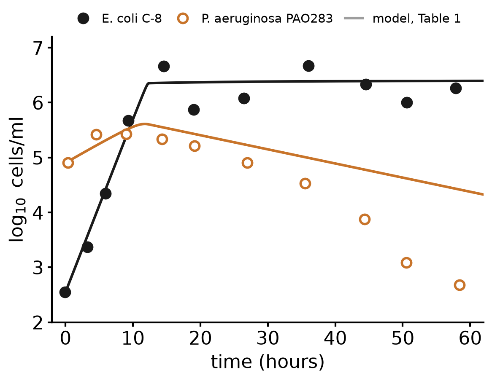
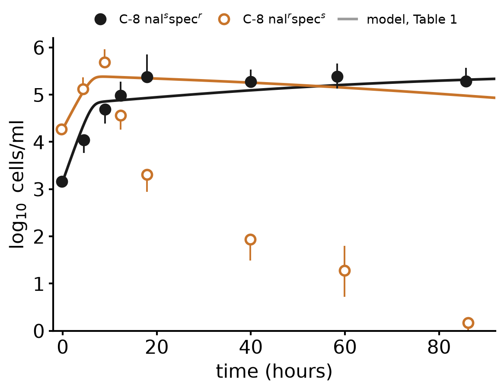
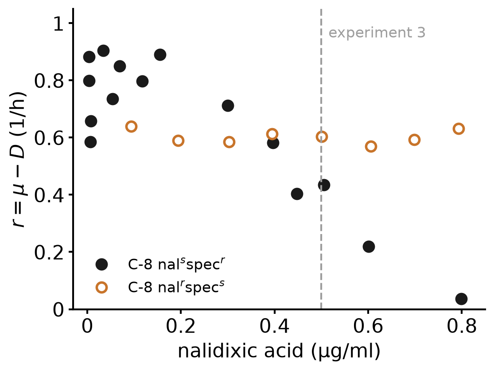
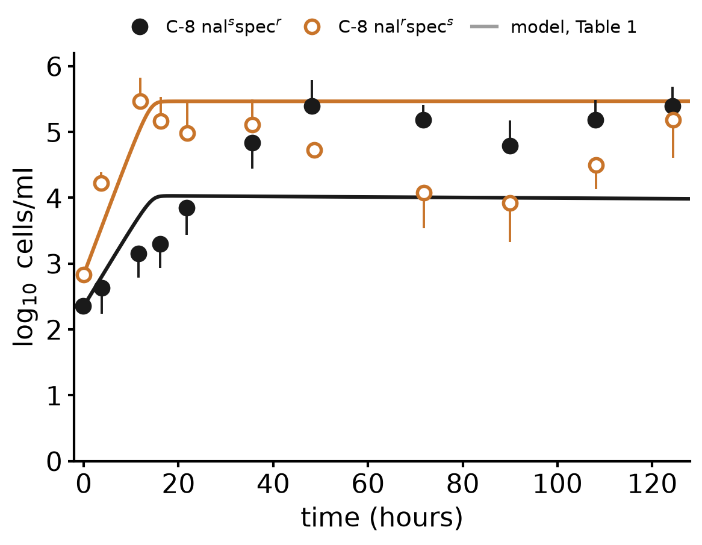
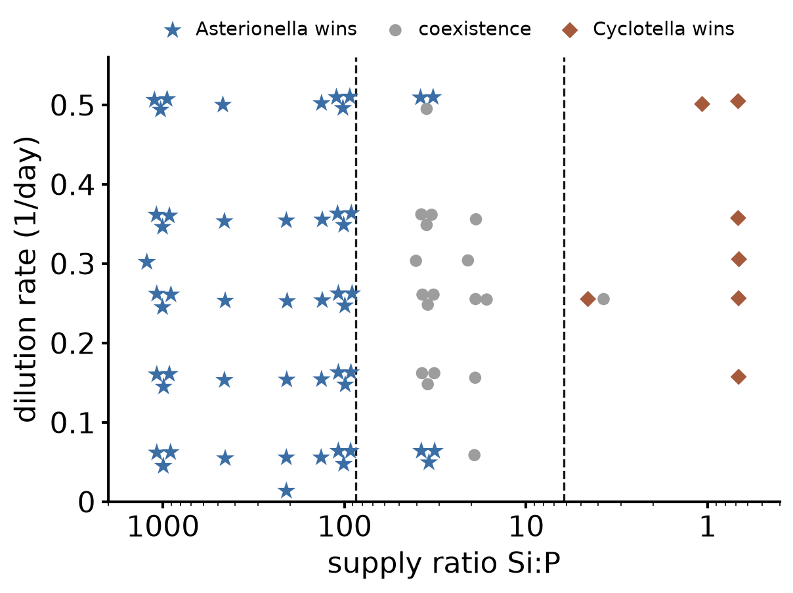
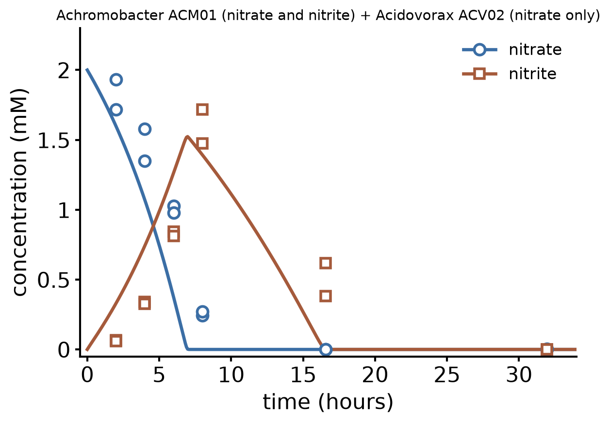

# Lecture 11. Competition for resources

Slides: [pdf](https://www.dropbox.com/scl/fi/6xy2py6oqzrr64474lmqj/L11.pdf?rlkey=yh7emkkqijny60zsm6nkjffs1&dl=1) · [keynote](https://www.dropbox.com/scl/fi/1z9vff1ricevcpi09lvdv/L11.key?rlkey=csoho2sbco9jg8ktk7u8prvdh&dl=1) · [powerpoint](https://www.dropbox.com/scl/fi/zknvsqh1dxakg7kxyx372/L11.pptx?rlkey=heugw47iycmq0bxecndbp1vt4&dl=1)

---

In [L6](l6.html) competition was a matter of coefficients $\alpha_{ij}$: how much one species slows the other. They have to be measured by putting the species together, so the model tells us what happens after we have watched it happen. Can we predict who wins from what we measure on each species *alone*?

When what the species compete for is a resource we can name and measure, yes. In [L4](l4.html) we made the resource explicit for one species. Here we do it for several.

## Chemostat

The open environment of [L4](l4.html) (*An open environment*) is realized in the laboratory by the [chemostat](https://en.wikipedia.org/wiki/Chemostat) ([Novick & Szilard 1950](https://doi.org/10.1126/science.112.2920.715)), with the dilution rate in the role of $d$, and it is also Malthus made quantitative: the population is set by the *rate* at which food arrives, and the check that holds it there is mortality.

### The chemostat, where the medium flows through

In the device that actually implements this experiment, fresh medium at concentration $R_{\text{in}}$ flows in and culture flows out at the same rate $D$, so the dilution removes resource *and* cells with one knob:

$$
\frac{dN}{dt} = \bigl( b\,\phi(R) - D \bigr) N ,
\qquad
\frac{dR}{dt} = D\,(R_{\text{in}} - R) - \frac{1}{Y}\,b\,\phi(R)\,N .
$$

Setting both to zero, the first gives $\phi(R^*)=D/b$, i.e. $R^*=K_R D/(b-D)$ — the cells titrate the resource down to whatever concentration makes them grow exactly as fast as they are being washed out — and the second gives the biomass as the resource consumed:

$$
\boxed{\ N^* = Y\left( R_{\text{in}} - \frac{K_R D}{b-D} \right)\ }
$$

Now the population does vanish smoothly. $N^*$ decreases with $D$ and reaches zero when $R^*=R_{\text{in}}$, that is at

$$
\boxed{\ D_c = b\,\phi(R_{\text{in}}) = \frac{b\,R_{\text{in}}}{K_R+R_{\text{in}}}\ }
$$

strictly below $b$. Above $D_c$ the only steady state left is **washout**, $N^*=0$ with $R^*=R_{\text{in}}$, and its stability follows from [the stability criterion of L4](l4.html#fixed-points-and-their-stability): a few cells added to a washed-out chemostat grow at rate $b\phi(R_{\text{in}})-D$, positive below $D_c$ and negative above. The two states therefore exchange stability at $D_c$: a [transcritical bifurcation](https://en.wikipedia.org/wiki/Transcritical_bifurcation), with the population going continuously to zero.

Two remarks for what follows. The steady-state resource $R^*$ does not depend on $R_{\text{in}}$, nor on the yield: it is set by the species ($K_R$, $b$) and by the dilution. And every population, at any density, has a per-capita rate $b\phi(R)-D\ge-D$: in a chemostat nothing can disappear faster than it is washed out.

## One resource, two species

Two species in the same chemostat, feeding on the same resource:

$$
\frac{dN_i}{dt} = \bigl(b_i\,\phi_i(R) - D\bigr)N_i ,
\qquad
\frac{dR}{dt} = D\,(R_{\text{in}}-R) - \sum_i \frac{b_i\,\phi_i(R)}{Y_i}\,N_i ,
\qquad
\phi_i(R)=\frac{R}{K_i+R},\quad i=1,2 .
$$

### The R* rule

A fixed point with $N_i^*>0$ needs $\phi_i(R^*)=D/b_i$, that is $R^*=R_i^*=K_iD/(b_i-D)$, the value species $i$ would reach alone. Both species present at once would need $R_1^*=R_2^*$: two conditions on one number. For generic parameters this does not happen, so **at most one species survives**.

Which one? Use the invasion criterion of [L6](l6.html#one-species-alone). Species $i$ alone sets the resource at $R_i^*$. A few cells of $j$ grow there at rate

$$
\lambda_{j|i} = b_j\,\phi_j(R_i^*) - D ,
$$

which is positive if and only if $\phi_j(R_i^*)>D/b_j=\phi_j(R_j^*)$, i.e. (since $\phi_j$ increases) $R_i^*>R_j^*$. So $j$ invades $i$ exactly when $R_j^*<R_i^*$, and $i$ cannot invade back:

$$
\boxed{\ \text{the species with the lowest } R^* \text{ excludes the others}\ }
$$

Each species alone draws the resource down to the level at which it just balances dilution. The one that can live on less draws it below what the other needs, and the other starves. This holds for any number of species on one resource, and from any initial condition ([Hsu, Hubbell & Waltman 1977](https://doi.org/10.1137/0132030)).

What decides the winner is a single number per species, measurable on each species alone, and it is a combination:

$$
R_i^* = \frac{K_i\,D}{b_i-D} .
$$

- The yield does not enter. How much biomass a species makes of the resource ($N^*$) is irrelevant; what matters is how low it can push the resource.
- At low dilution $R_i^*\simeq K_iD/b_i$: the species with the best affinity per unit growth, the smallest $K_i/b_i$, wins. Close to washout, $R_i^*$ diverges at $D=b_i$, and the fast grower wins.
- So the winner can change with $D$ only if the species with the smaller $K$ also has the smaller $b$: a trade-off between affinity and speed, between a "gleaner" and an "opportunist". It is the same structure as mortality in [L6](l6.html#adding-mortality): a reversal needs a trade-off.
- The loser declines at rate $|\lambda_{\text{loser}|\text{winner}}|\le D$, slowly when the two $R^*$ are close.

### Tryptophan in a chemostat

[Hansen & Hubbell 1980](https://doi.org/10.1126/science.6767274) tested the rule on a nutrient, with bacteria that cannot make tryptophan and have to take it from the medium. They measured $K$ and the maximal growth rate $\mu$ (our $b$) of each strain in batch culture, computed $R^*$ (they call it $J$), predicted the winner, and only then grew the strains together in tryptophan-limited chemostats at 34 °C.

| Exp. | Strains | $K$ (µg/l) | $\mu$ (1/h) | $D$ (1/h) | $R^*$ (µg/l) | Predicted |
| --- | --- | --- | --- | --- | --- | --- |
| 1 | *E. coli* C-8 | 3 | 0.81 | 0.06 | 0.24 | C-8 wins |
|   | *P. aeruginosa* PAO283 | 310 | 0.91 | 0.06 | 21.9 | |
| 2 | C-8 nal$^s$spec$^r$ | 1.6 | 0.96 | 0.075 | 0.135 | nal$^s$spec$^r$ wins |
|   | C-8 nal$^r$spec$^s$ | 1.6 | 0.68 | 0.075 | 0.198 | |
| 3 | C-8 nal$^s$spec$^r$ + nalidixic acid | 0.9 | 0.41 | 0.075 | 0.199 | no exclusion |
|   | C-8 nal$^r$spec$^s$ | 1.6 | 0.68 | 0.075 | 0.198 | |

**Experiment 1: affinity.** *P. aeruginosa* grows faster, but its $K$ is 100 times larger, and so is its $R^*$. *E. coli* wins, although it started 200 times rarer.

> [!figure] Experiment 1: *E. coli* C-8 against *P. aeruginosa* PAO283
> Cells per ml in a tryptophan-limited chemostat ($D=0.06$/h). Points: data of Hansen & Hubbell 1980 (Fig. 1a, digitized). Lines: the model above, with the parameters measured on each strain alone (their Table 1), integrated from the first data points.
>
> 

**Experiment 2: speed.** Two clones of the same *E. coli* strain, marked by resistance to different antibiotics, with the same $K$ but different growth rates. The faster has the lower $R^*$ and wins, again from a numerical disadvantage.

> [!figure] Experiment 2: same affinity, different growth rates
> Two clones of *E. coli* C-8 ($D=0.075$/h). Points: data (Fig. 1b, digitized); bars: range of three replicates. Lines: the model with Table 1.
>
> 

**Experiment 3: equal $R^*$.** Nalidixic acid slows one of the two clones and leaves the other unaffected. At 0.5 µg/ml the slowed clone has a lower $K$ and a lower $\mu$, and the same $R^*$ as the other, within 1%. Neither excluded the other over the 125 hours of the run.

> [!figure] Tuning a growth rate with an antibiotic
> Growth rate $\mu-D$ of the two clones against nalidixic acid (Fig. 1c, digitized). The dashed line is the concentration used in experiment 3.
>
> 

> [!figure] Experiment 3: equal $R^*$
> Same clones, with 0.5 µg/ml nalidixic acid. Points: data (Fig. 1d, digitized). Lines: the model with Table 1.
>
> 

What the experiments show:

- The winner is predicted from measurements on each strain alone, including against a head start. This is the point of the theory: in [L6](l6.html) the outcome followed from coefficients measured on the mixture.
- Equal $R^*$ is a knife-edge. In the model the two clones are then neutral: when the resource reaches the common $R^*$ the composition freezes wherever it is, here with the slow clone 30 times rarer. In the data the slow clone catches up. "Coexistence" in experiment 3 means no exclusion over nine residence times, not a stable mixture.
- Across the knife-edge. Adding more or less acid moves one $R^*$ across the other: on one side one clone wins, on the other side the other. At the crossing the two single-clone states are joined by a line of fixed points, $\sum_jN_j^*/Y_j=R_{\text{in}}-R^*$ (exercise 1). The total population changes continuously, but the fraction of a clone jumps from 0 to 1. The two fixed points never meet: it is not one of the bifurcations of [L5](l5.html).
- The lines are our integration of their model with their published parameters. The curves drawn as predictions in their figure could not be reproduced from those parameters.

## Many species, many resources

### Competitive exclusion, in general

Take $S$ species and $R$ resources, with any growth on any resources,

$$
\frac{dN_i}{dt} = N_i\bigl(g_i(R_1,\dots,R_R) - d_i\bigr) ,
$$

with whatever resource dynamics. A fixed point with $S$ species present needs $g_i(R^*)=d_i$ for each of them: $S$ equations for the $R$ unknowns $R^*_\alpha$. For generic parameters,

$$
\boxed{\ S\le R\ }
$$

the *competitive exclusion principle* ([Hardin 1960](https://doi.org/10.1126/science.131.3409.1292); [Levin 1970](https://doi.org/10.1086/282676)). One resource, one winner, as in the $R^*$ rule. The ways around it are the ways around its assumptions: non-generic parameters (experiment 3), populations that never settle at a fixed point ([Armstrong & McGehee 1980](https://doi.org/10.1086/283553)), and limiting factors other than resources (predators, L12; space, L19). The phytoplankton in a lake, dozens of species on a handful of nutrients, is the paradox of L17.

## Two resources

Two diatoms of Lake Michigan, *Asterionella formosa* and *Cyclotella meneghiniana*, both need silicate (for their shell) and phosphate. Two resources: by the counting above, two species may coexist. Which outcome, and when?

### Essential resources

Silicate and phosphate are *essential*: one cannot replace the other, and growth is set by the one in shortest supply (Liebig's law of the minimum). Tilman's model ([Tilman 1977](https://doi.org/10.2307/1935608)) is the chemostat above with

$$
\frac{dN_i}{dt} = N_i\Bigl(\min_\alpha\, b_{i\alpha}\,\frac{R_\alpha}{K_{i\alpha}+R_\alpha} - D\Bigr),
\qquad \alpha\in\{\text{Si},\text{P}\} ,
$$

and each resource supplied at $R_\alpha^{\text{in}}$ and consumed in proportion to growth, $1/Y_{i\alpha}$ per cell made.

When only resource $\alpha$ limits, a species is in the chemostat with one resource, and it draws that resource down to $R^*_{i\alpha}=K_{i\alpha}D/(b_{i\alpha}-D)$.

From the parameters measured on each species alone ([Tilman & Kilham 1976](https://doi.org/10.1111/j.1529-8817.1976.tb02860.x)), at $D=0.25$/day:

| | $R^*_{\text{Si}}$ (µM) | $R^*_{\text{P}}$ (µM) | consumption Si:P $=Y_{\text{P}}/Y_{\text{Si}}$ |
| --- | --- | --- | --- |
| *Asterionella* | 1.92 | 0.013 | 87 |
| *Cyclotella* | 0.55 | 0.21 | 6.2 |

*Asterionella* needs 15 times less phosphate, *Cyclotella* 3.5 times less silicate: each is the better competitor for one resource.

### Which resource limits

A species consumes the two resources in a fixed proportion, its consumption ratio Si:P $=Y_{\text{P}}/Y_{\text{Si}}$: 87 for *Asterionella*, 6.2 for *Cyclotella*. If the supply has more silicate per phosphate than the species consumes, phosphate runs out first and limits it; if less, silicate does (for supplies well above the $R^*$). So the supply ratio decides:

- **Si:P above 87.** Phosphate is scarce for both. The lower $R^*_{\text{P}}$ wins: *Asterionella*.
- **Si:P between 6.2 and 87.** Each species is limited by a different resource. They coexist.
- **Si:P below 6.2.** Silicate is scarce for both: *Cyclotella*.

Two resources make coexistence possible, not granted: the two species must be limited by different resources. (For the mixture to be stable, each must also eat relatively more of the resource that limits itself, as these two do; Tilman 1982.)

### The experiment

Tilman grew the two species together in 76 cultures diluted once a day, for 30 to 40 days, at supply ratios from 1 to 1000 and dilution rates from 0.05 to 0.5 per day, with each species alone as a control at every condition. A species was called dominant at more than 95% of the cells.

The boundaries were computed in advance, from the parameters measured on each species alone. 70 of the 76 outcomes fall in the predicted region. The six misses: *Asterionella* wins at Si:P ≈ 38 at the lowest and highest dilution rates, where coexistence was predicted (the boundary curves, and neither of Tilman's models predicts the curvature), and one coexistence at Si:P ≈ 4.

> [!figure] 76 competition experiments
> Outcome against the supply ratio (log scale, decreasing to the right as in the paper) and the dilution rate. Replicates are drawn as small groups around their supply ratio. Dashed: the predicted boundaries, the consumption ratios 87 and 6.2. Data: Tilman 1977, Fig. 12 (digitized).
>
> 

## From resources to Lotka–Volterra

How do the $\alpha_{ij}$ of L6 come out of resources? Take $S$ species and $R$ resources that renew themselves (a prey, a plant), each species with its own preferences $c_{i\alpha}\ge0$:

$$
\frac{dN_i}{dt} = N_i\Bigl(\sum_\alpha c_{i\alpha}R_\alpha - d_i\Bigr) ,
\qquad
\frac{dR_\alpha}{dt} = \frac{R_\alpha}{\tau_R}\Bigl(1-\frac{R_\alpha}{R_0}-\sum_j c_{j\alpha}N_j\Bigr) .
$$

This is MacArthur's consumer–resource model ([MacArthur 1970](https://doi.org/10.1016/0040-5809(70)90039-0)). If the resources are fast, $\tau_R$ much shorter than the time over which the consumers change, they are always at their quasi-steady state, as in [L4](l4.html) (*An open environment*):

$$
R_\alpha^*(N) = R_0\Bigl(1-\sum_j c_{j\alpha}N_j\Bigr)
$$

(as long as it is positive). Substituting,

$$
\boxed{\ \frac{dN_i}{dt} = N_i\Bigl(r_i-\sum_j A_{ij}N_j\Bigr),
\qquad r_i = R_0\sum_\alpha c_{i\alpha}-d_i ,
\qquad A_{ij} = R_0\sum_\alpha c_{i\alpha}c_{j\alpha}\ }
$$

the generalized Lotka–Volterra model of [L6](l6.html#many-species-with-symmetric-interactions), with $\beta=A$. Now the coefficients have a meaning:

- **$A_{ij}$ is the overlap of the diets of $i$ and $j$.** Two species compete as much as they eat the same things. Since $A_{ij}$ is a scalar product, $A_{12}A_{21}=A_{12}^2\le A_{11}A_{22}$ (Cauchy–Schwarz): in the units of L6, $a_{12}a_{21}\le1$. Competition through shared resources alone never gives bistability.
- **$A$ is symmetric.** So the Lyapunov function of L6 exists: a single stable state, the one no absent species can invade (MacArthur's minimum principle).
- **$A=R_0\,CC^{\mathsf T}$ has rank at most $R$**, the number of resources. The coexistence point solves $\sum_jA_{ij}N_j^*=r_i$ for all present species. With $S>R$ present species $A$ is singular, and for generic $r_i$ there is no solution: at most $R$ species can coexist, as in [competitive exclusion](#competitive-exclusion-in-general).

## One species' waste is another's resource

So far species only took from the resources. Many microbes also release what others use. In denitrification, nitrogen oxides are used for respiration in a chain,

$$
\text{NO}_3^- \to \text{NO}_2^- \to \text{NO} \to \text{N}_2\text{O} \to \text{N}_2 ,
$$

and the steps can be split among species: some reduce nitrate to nitrite and release it, others reduce nitrite.

[Gowda et al. 2022](https://doi.org/10.1016/j.cell.2021.12.036) isolated 78 denitrifying strains from soil (and added a reference strain), of three types: *Nar* (nitrate → nitrite only), *Nir* (nitrite → NO only) and *Nar/Nir* (both). In batch, nitrate $A$ and nitrite $I$, with biomass $x_i$:

$$
\frac{dx_i}{dt} = \Bigl(\gamma_{iA}\,r_{iA}\frac{A}{K+A}+\gamma_{iI}\,r_{iI}\frac{I}{K+I}\Bigr)x_i ,
\qquad
\frac{dA}{dt} = -\sum_i r_{iA}\frac{A}{K+A}\,x_i ,
\qquad
\frac{dI}{dt} = \sum_i \Bigl(r_{iA}\frac{A}{K+A}-r_{iI}\frac{I}{K+I}\Bigr)x_i .
$$

The new term is the first one in $dI/dt$: every nitrate reducer *produces* nitrite, one for one. A Nar strain has $r_I=\gamma_I=0$, a Nir strain $r_A=\gamma_A=0$. This is a batch culture: no dilution, no steady state, and the $K$ are too small to measure, so here it is a race for the resources, not an $R^*$ contest.

The parameters of each strain were fitted on that strain alone. Then 66 pairs, 81 trios, 21 quartets and 6 quintets from 12 of the strains were grown together, and the model predicted the nitrate and nitrite curves with no further parameter. It works in most cases, including the transient accumulation of nitrite when a Nar strain releases it faster than the Nar/Nir strain uses it.

> [!figure] A pair where the prediction works
> *Achromobacter* ACM01 (Nar/Nir) with *Acidovorax* ACV02 (Nar), 2 mM nitrate at the start. Points: two replicates. Lines: the model with the parameters of each strain alone. Data: Gowda et al. 2022 (OSF).
>
> 

It fails, systematically, for a Nar strain with a Nir strain, where the second step needs the other species: the likely reason is nitric oxide, toxic and not in the model.

The counting of [competitive exclusion](#competitive-exclusion-in-general) still holds, with the resources that species produce counted along with those supplied. In the long-term evolution experiment, the two clades that coexist for thousands of generations live on two resources: the glucose that is supplied, and the acetate that one of them releases and the other is better at using ([L10](l10.html#coexisting-clades)).

## Exercises

1. Two species on one resource in a chemostat. Show that if $R_1^*=R_2^*$ there is a line of fixed points, and find it. What happens to a small perturbation along it?
2. Show that the invasion rate $\lambda_{j|i}=b_j\phi_j(R_i^*)-D$ is always larger than $-D$. Use the data of experiments 1 and 2 to estimate how much faster than washout the losers declined.
3. Experiment 1: compute $R^*$ of both strains at $D=0.06$/h from the table, and the dilution rate at which their order reverses.
4. Gleaner and opportunist: $K_1<K_2$ and $b_1<b_2$. Find $D_\times$ where $R_1^*=R_2^*$, and which species wins below and above it.
5. In the MacArthur model, derive $A_{ij}=R_0\sum_\alpha c_{i\alpha}c_{j\alpha}$. With $S=3$ species and $R=2$ resources, find the direction in which $A$ is singular.
6. Nar + Nir in batch with fixed biomasses and $K\to0$ (both reactions at maximal rate while their substrate lasts). Find $A(t)$, $I(t)$, and the maximum of $I$. When does nitrite accumulate?

## At home

- S. B. Hsu, S. Hubbell, P. Waltman (1977), the proof that the lowest $R^*$ wins from any start.
- D. Tilman, *Resource Competition and Community Structure* (1982), for the graphical theory of two resources, including substitutable ones.
- W. Cui, R. Marsland, P. Mehta, *Les Houches lectures on community ecology*, for consumer–resource models with many species (also for L17–L18).

## References

- A. Novick, L. Szilard, [Description of the chemostat](https://doi.org/10.1126/science.112.2920.715), *Science* **112**, 715 (1950).
- S. B. Hsu, S. Hubbell, P. Waltman, [A mathematical theory for single-nutrient competition in continuous cultures of micro-organisms](https://doi.org/10.1137/0132030), *SIAM J. Appl. Math.* **32**, 366 (1977).
- S. R. Hansen, S. P. Hubbell, [Single-nutrient microbial competition: qualitative agreement between experimental and theoretically forecast outcomes](https://doi.org/10.1126/science.6767274), *Science* **207**, 1491 (1980).
- R. MacArthur, [Species packing and competitive equilibrium for many species](https://doi.org/10.1016/0040-5809(70)90039-0), *Theor. Popul. Biol.* **1**, 1 (1970).
- G. Hardin, [The competitive exclusion principle](https://doi.org/10.1126/science.131.3409.1292), *Science* **131**, 1292 (1960).
- S. A. Levin, [Community equilibria and stability, and an extension of the competitive exclusion principle](https://doi.org/10.1086/282676), *Am. Nat.* **104**, 413 (1970).
- R. A. Armstrong, R. McGehee, [Competitive exclusion](https://doi.org/10.1086/283553), *Am. Nat.* **115**, 151 (1980).
- D. Tilman, S. S. Kilham, [Phosphate and silicate growth and uptake kinetics of the diatoms *Asterionella formosa* and *Cyclotella meneghiniana* in batch and semicontinuous culture](https://doi.org/10.1111/j.1529-8817.1976.tb02860.x), *J. Phycol.* **12**, 375 (1976).
- D. Tilman, [Resource competition between planktonic algae: an experimental and theoretical approach](https://doi.org/10.2307/1935608), *Ecology* **58**, 338 (1977).
- D. Tilman, *Resource Competition and Community Structure* (Princeton University Press, 1982).
- K. Gowda, D. Ping, M. Mani, S. Kuehn, [Genomic structure predicts metabolite dynamics in microbial communities](https://doi.org/10.1016/j.cell.2021.12.036), *Cell* **185**, 530 (2022); data: [OSF](https://doi.org/10.17605/osf.io/t3prd).
