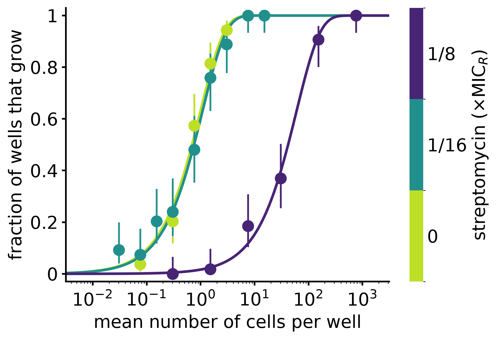
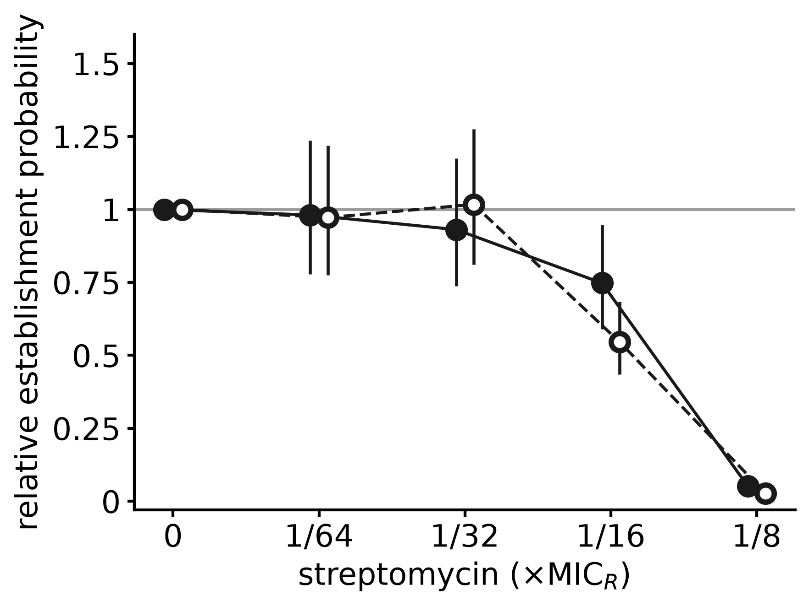

# Lecture 2. Demographic noise and stochastic extinctions

Slides: [pdf](https://www.dropbox.com/scl/fi/6poor7z4fds6h8kghf0z1/L2.pdf?rlkey=rh9xhdf3cr2yz6ar6ipe56tn4&dl=1) · [keynote](https://www.dropbox.com/scl/fi/3a8xhi8wdgpv2x4s5rsmx/L2.key?rlkey=jhtkro0fuiy82jiqeoah9zo5a&dl=1) · [powerpoint](https://www.dropbox.com/scl/fi/ka0r2fwthz0su89fli8al/L2.pptx?rlkey=ce4cpg659x9xd4qtfjtkzxa6k&dl=1)

---

## The observation

Put a population with $b>d$ in a favourable environment and the deterministic model of [L1](l1.html) says it grows. 

Stochastic clearance. Bacterial population treated with a bactericidal antibiotic at a fixed concentration show a non-deterministic outcome. Replicate populations either clear or survive, and the fraction that clears is quantitatively captured by a [birth–death process](https://en.wikipedia.org/wiki/Birth%E2%80%93death_process) with a killing rate. Extinction is a *probability*, not a threshold ([Coates et al. 2018](https://doi.org/10.7554/eLife.32976)).

A population with $b>d$ can go extinct. With what probability? How does that depend on how many individuals we started with? 

## What a rate is

A rate is a **probability per unit time**. For small enough $\Delta t$, the three possible outcomes are

$$
n(t+\Delta t) =
\begin{cases}
n(t)+1 & \text{w.p.}\quad b\,n(t)\,\Delta t \\[2pt]
n(t)-1 & \text{w.p.}\quad d\,n(t)\,\Delta t \\[2pt]
n(t)   & \text{w.p.}\quad 1-(b+d)\,n(t)\,\Delta t
\end{cases}
$$

"Small enough" means small enough that two events in the same interval have probability $O(\Delta t^2)$ and can be dropped.

### Master equation

In general, for configurations $C$ with transition rates $W_{C\to C'}$,

$$
P(C,t+\Delta t) = P(C,t) + \Delta t \sum_{C'} \Bigl[ P(C',t) W_{C'\to C} - P(C,t) W_{C\to C'} \Bigr]
$$

$$
\boxed{\ \frac{\partial P(C,t)}{\partial t} = \sum_{C'} P(C',t) W_{C'\to C} - P(C,t) W_{C\to C'}\ }
$$

gain minus loss. For the birth–death process, $C=n\in\mathbb{N}$ and $W_{n\to n+1}=bn$, $W_{n\to n-1}=dn$:

$$
\frac{\partial P(n,t)}{\partial t} = b(n-1)P(n-1,t) + d(n+1)P(n+1,t) - (b+d)\,n\,P(n,t) ,
\qquad n\ge 1
$$

This is incomplete: $n=0$ needs its own equation, because there is no transition *out* of it,

$$
\frac{\partial P(0,t)}{\partial t} = d\,P(1,t) .
$$

$n=0$ is an **[absorbing state](https://en.wikipedia.org/wiki/Absorbing_Markov_chain)**. This single boundary condition is the whole content of the lecture: without it the process would be a [random walk](https://en.wikipedia.org/wiki/Random_walk) in $\log n$ and nothing interesting would happen.

## The mean obeys the deterministic equation

Multiply by $n$ and sum (or take the average of the three-outcome rule directly):

$$
\langle n(t+\Delta t)\rangle = \langle n(t)\rangle + b\,\langle n(t)\rangle \Delta t - d\,\langle n(t)\rangle \Delta t
\ \Longrightarrow\
\frac{d\langle n\rangle}{dt} = (b-d)\langle n\rangle ,
$$

$$
\langle n(t)\rangle = n_0\, e^{(b-d)t} .
$$

The average reproduces [L1](l1.html) exactly. This is a special feature of **linear** rates, not a general rule: as soon as $W$ is nonlinear in $n$, the equation for $\langle n \rangle$ involves $\langle n^2\rangle$ and the deterministic equation is only an approximation. 

And the average is about to turn out to be a poor description of any single trajectory.

## The second moment and the variance

The same bookkeeping gives the second moment. In a short interval $\Delta t$, $n^2$ becomes $(n+1)^2=n^2+2n+1$ with probability $b\,n\,\Delta t$, becomes $(n-1)^2=n^2-2n+1$ with probability $d\,n\,\Delta t$, and stays $n^2$ otherwise:

$$
\langle n^2(t+\Delta t)\rangle = \langle n^2\rangle + b\,\langle (2n+1)\,n\rangle\,\Delta t + d\,\langle (1-2n)\,n\rangle\,\Delta t
\ \Longrightarrow\
\frac{d\langle n^2\rangle}{dt} = 2(b-d)\langle n^2\rangle + (b+d)\langle n\rangle .
$$

The equation for $\langle n^2\rangle$ involves only $\langle n^2\rangle$ and $\langle n\rangle$: the hierarchy closes, again because the rates are linear.

What we are after is the variance, $\operatorname{var} n=\langle n^2\rangle-\langle n\rangle^2$. Differentiate it and insert the two equations we now have, $d\langle n^2\rangle/dt = 2(b-d)\langle n^2\rangle+(b+d)\langle n\rangle$ and $d\langle n\rangle/dt = (b-d)\langle n\rangle$:

$$
\frac{d\operatorname{var} n}{dt}
= \frac{d\langle n^2\rangle}{dt} - 2\langle n\rangle\frac{d\langle n\rangle}{dt}
= \Bigl[ 2(b-d)\langle n^2\rangle + (b+d)\langle n\rangle \Bigr] - 2(b-d)\langle n\rangle^2 ,
$$

and the two terms proportional to $b-d$ recombine into the variance itself:

$$
\boxed{\ \frac{d\operatorname{var} n}{dt} = 2(b-d)\,\operatorname{var} n + (b+d)\,\langle n\rangle\ }
$$

Two effects, one per term. Every event moves $n$ by one, so the total event rate $(b+d)\langle n\rangle$ is also the rate at which variance is *injected* — the only place where the turnover enters. Whatever variance is already there is then carried along by the growth, at twice the rate of the mean, because the variance is quadratic in $n$.

The equation is linear in $\operatorname{var} n$ and its source is known, since we already solved for $\langle n(t)\rangle$: writing $r=b-d$, it is $\dot V = 2rV + f(t)$ with $f(t) = (b+d)\,n_0e^{rt}$. Multiplying by $e^{-2rt}$ turns the left-hand side into a total derivative,

$$
\frac{d}{dt}\Bigl( e^{-2rt}\operatorname{var} n \Bigr) = e^{-2rt} f(t) ,
$$

which integrates from $0$ to $t$ with $\operatorname{var} n(0)=0$ — at $t=0$ the population is exactly $n_0$, with no spread:

$$
\operatorname{var} n(t) = \int_0^t \! ds\ e^{2r(t-s)}\, f(s) = (b+d)\,n_0\int_0^t \! ds\ e^{2r(t-s)}\,e^{rs} .
$$

The integral is elementary — take $e^{2rt}$ out and integrate $e^{-rs}$:

$$
\int_0^t \! ds\ e^{2r(t-s)}\,e^{rs} = e^{2rt}\int_0^t \! ds\ e^{-rs} = e^{2rt}\,\frac{1-e^{-rt}}{r} = \frac{e^{rt}\left(e^{rt}-1\right)}{r} ,
$$

so that

$$
\boxed{\ \operatorname{var} n(t) = n_0\,\frac{b+d}{b-d}\,e^{(b-d)t}\left(e^{(b-d)t}-1\right)\ }
$$

For $b=d$ the prefactor $(e^{rt}-1)/r$ is to be read as its limit $t$, which gives the critical case below.

Three regimes:

- $b>d$: at long times $\operatorname{var} n \simeq n_0 \frac{b+d}{b-d} e^{2(b-d)t}$, so the **squared [coefficient of variation](https://en.wikipedia.org/wiki/Coefficient_of_variation) is constant**,
  $$
  \frac{\operatorname{var} n}{\langle n\rangle^2} \ \xrightarrow[t\to\infty]{}\ \frac{1}{n_0}\,\frac{b+d}{b-d} .
  $$
  Relative fluctuations do not decay: the noise is not averaged away by growth, it is *frozen in* by it. What happens early, when $n$ is small, sets the trajectory forever.
- $b<d$: mean and variance both $\to 0$.
- $b=d$ (critical): $\langle n\rangle = n_0$ for all times, while $\operatorname{var} n = n_0(b+d)t$ grows without bound. The mean is a useless summary.

Note that $b+d$ — the **turnover**, invisible in [L1](l1.html) — controls all of the fluctuations. 

## Expected number of deaths

The per-capita death rate is $d$, and therefore the expected number of death cells is
$$
\frac{d}{dt }\langle n_D(t) \rangle = d \langle n(t)\rangle
$$
Using 
$$
\frac{d\langle n\rangle}{dt} = (b-d)\langle n\rangle
$$
we can write
$$
\frac{d}{dt}\langle n_D(t)\rangle = \frac{d}{b-d}\,\frac{d\langle n(t)\rangle}{dt}
\quad\Longrightarrow\quad
\langle n_D(t)\rangle = \frac{d}{b-d}\bigl(\langle n(t)\rangle - n_0\bigr) = \frac{d\,n_0}{b-d}\left(e^{(b-d)t}-1\right)
$$
(for $b=d$, $\langle n_D(t)\rangle = d\,n_0\,t$). For $b>d$, at long times there are $d/(b-d)$ deaths per living individual

Plotted against $\langle n(t)\rangle$, the cumulative number of deaths is a straight line of slope $d/(b-d)$. With $b-d$ read off the growth of the mean, this measures the death rate $d$ from time-lapse movies, which is how it is done for the antibiotic experiments of [the observation](#the-observation).

## Extinction probability

$n=0$ is absorbing: once there, the population stays there. The simplest way to compute the probability of ending up there is to look at the first event.

Let $q$ be the probability that all the descendants of one individual eventually go extinct. The first event is a birth with probability $b/(b+d)$ or a death with probability $d/(b+d)$. If it is a death, we are done; if it is a birth, we now have two independent lineages, each of which must die out:

$$
q = \frac{d}{b+d} + \frac{b}{b+d}\, q^2
\quad\Longrightarrow\quad
b q^2 - (b+d) q + d = 0
\quad\Longrightarrow\quad
q \in \left\{ 1,\ \frac{d}{b} \right\} .
$$

Which root? Count generations of this split-or-die process (a [branching process](https://en.wikipedia.org/wiki/Branching_process)): the probability $q_k$ of dying out within $k$ generations obeys $q_{k+1}=\frac{d}{b+d}+\frac{b}{b+d}\,q_k^2$ with $q_0=0$, so it increases with $k$ and converges to the first root it meets: $q=1$ for $d\ge b$, $q=d/b$ for $b>d$. The $n_0$ initial lineages are independent, so

$$
P_{\text{ext}} = \lim_{t\to\infty} P(0,t) =
\begin{cases}
1 & d \ge b \\[4pt]
\left( \dfrac{d}{b}\right)^{n_0} & d < b
\end{cases}
$$

Even with $b>d$, extinction has **finite probability**, decaying exponentially in the initial population size. Equivalently, the probability of **establishment** is

$$
\boxed{\ P_{\text{est}} = 1 - \left(\frac{d}{b}\right)^{n_0} \ \xrightarrow[n_0=1]{}\ \frac{b-d}{b} = \frac{r}{b}\ }
$$

For a population starting from one cell with a small advantage, $b=1+s$, $d=1$: $P_{\text{est}} = s/(1+s)\approx s$. 

### What survivors look like

Conditioning on survival: since extinct trajectories contribute nothing to the mean,

$$
\langle n(t)\rangle = 0\cdot P(0,t) + \bigl(1-P(0,t)\bigr)\,\langle n(t)\rangle_{\text{NE}} ,
$$

$$
\boxed{\ \langle n(t)\rangle_{\text{NE}} = \frac{\langle n(t)\rangle}{1-P(0,t)}
\ \xrightarrow[t\to\infty]{}\ \frac{n_0\,e^{rt}}{1-(d/b)^{n_0}}\ }
$$

For $n_0=1$ this is $(b/r)\,e^{rt}$: **survivors grow with the same rate but a larger amplitude**. The populations we observe are, by construction, the ones that did not go extinct, so they look systematically "better" than the model predicts. This is a [survivorship bias](https://en.wikipedia.org/wiki/Survivorship_bias) in a two-parameter model — worth remembering whenever a fitted growth curve looks too good.

## Simulating exactly with Gillespie

Do not discretise time — sample the events ([Gillespie algorithm](https://en.wikipedia.org/wiki/Gillespie_algorithm)). In state $n$, the total event rate is $R(n) = (b+d)n$. The probability that *nothing* happens in $[t,t+\tau]$ is

$$
P_{\text{no event}}(\tau) = \lim_{\Delta t\to0}\bigl(1 - R\Delta t\bigr)^{\tau/\Delta t} = e^{-R\tau} ,
$$

so the waiting time to the next event is [exponential](https://en.wikipedia.org/wiki/Exponential_distribution) with rate $R$, and the event that happens is chosen with probability proportional to its own rate:

1. draw $\tau \sim \text{Exp}(R(n))$, set $t \leftarrow t+\tau$;
2. with probability $bn/R$ set $n\leftarrow n+1$, otherwise $n \leftarrow n-1$;
3. stop when $n=0$ or $t>t_{\max}$.

This is **exact**: no time-step error, unlike the ODE integrators of [L1](l1.html). The cost is that the algorithm slows down as $n$ grows, which is exactly when the deterministic description becomes accurate.

## Additional material. Single resistant cells under antibiotic

*Not covered in class.* The extinction probability can be measured one cell at a time. How likely is a single cell to give rise to a population, at a concentration of antibiotic where a large culture of the same cells grows? [Alexander & MacLean 2020](https://doi.org/10.1073/pnas.1919672117) measured it for resistant bacteria.

**Setup.**

- *Pseudomonas aeruginosa* carrying a plasmid that makes it resistant to streptomycin. Its minimal inhibitory concentration (MIC), measured with the standard inoculum of $10^5$ cells, is $\text{MIC}_R=2048$ µg/ml. The sensitive strain, without the plasmid, stops growing at $\text{MIC}_R/64$.
- An overnight culture is diluted so much that each well of a 96-well plate receives on average about one cell. The number of cells in a well is random, Poisson ([L3](l3.html)).
- The wells contain fresh medium with streptomycin, from 0 to $\text{MIC}_R/8$. After three days, a well has either grown or is still clear.
- In a second experiment, the mean number of cells per well goes from 0.03 to about 800, at three concentrations.

**The model.** Each cell starts its own lineage, which establishes with probability $p$, independently of the others. A well that receives $n$ cells stays clear with probability $(1-p)^n$. For the birth–death process $1-p=d/b$, and this is the extinction probability $(d/b)^{n_0}$ of [above](#extinction-probability). Averaging over the Poisson number of cells, with mean $\lambda$,

$$
P(\text{clear})=\sum_{n=0}^\infty e^{-\lambda}\frac{\lambda^n}{n!}\,(1-p)^n=e^{-\lambda}\,e^{\lambda(1-p)}=e^{-\lambda p},
$$

so a well grows with probability

$$
P(\text{grow})=1-e^{-\lambda p} .
$$

$\lambda$ is known only up to a factor, because not every cell would establish even without antibiotic. What the data give is $p(c)/p(0)$, the *relative establishment probability* at concentration $c$, with $\lambda p(0)$ calibrated on the wells without antibiotic. Against $\ln\lambda$, the curve $1-e^{-\lambda p}$ has the same shape for every $p$, shifted by $-\ln p$. We fit $\lambda$ and $p(c)$ by maximum likelihood (binomial, each well grows or not).

**What the data show.** The fraction of wells that grow follows $1-e^{-\lambda p}$ over four orders of magnitude of $\lambda$, at every concentration: each cell establishes independently of the others. At $\text{MIC}_R/16$ the curve does not move ($p=0.92$, 95% interval 0.71–1.19). At $\text{MIC}_R/8$ it shifts by a factor 60: $p=0.017$ (0.012–0.023).

> [!figure] One cell at a time
> Fraction of wells that grow against the mean number of cells per well (log scale), without streptomycin and at $\text{MIC}_R/16$ and $\text{MIC}_R/8$ (colour); 48–54 wells per point, ± 95% interval. The mean number of cells is calibrated on the wells without antibiotic. Lines: $1-e^{-\lambda p}$, one $p$ fitted for each concentration. Data: Alexander & MacLean 2020.
>
> 

With about one cell per well, the establishment probability falls from 1 to 0.03–0.05 between $\text{MIC}_R/32$ and $\text{MIC}_R/8$, in two experiments. With another plasmid and another antibiotic (meropenem) it is 0.05 at $\text{MIC}_R/8$, and no well out of 192 grew at $\text{MIC}_R/4$.

> [!figure] Establishment probability of a resistant cell
> Establishment probability of a single resistant cell relative to the one without antibiotic, against streptomycin in units of $\text{MIC}_R$; two experiments (filled, open), ± 95% interval. Fit of $1-e^{-\lambda p}$ to 96 wells at each of three dilutions. Data: Alexander & MacLean 2020.
>
> 

At $\text{MIC}_R/8$ a culture of $10^5$ resistant cells grows, while the sensitive strain is at 8 times its own MIC. Yet a single resistant cell gives rise to a population about 4 times out of 100. In the language of the birth–death process, $d/b\simeq0.96$ (or closer to 1, if not every cell establishes without antibiotic): the population grows, $b>d$, but most lineages die out. The antibiotic does not stop the resistant cells, it kills more of them. The authors saw it directly: after 7 hours at $\text{MIC}_R/8$, more than 20% of the cells are dead, against 3–4% without antibiotic. As for the bactericidal drug of [the observation](#the-observation), the fate of a cell is decided by $d/b$, not by the growth rate $b-d$ alone.

This also explains what the MIC is. A culture inoculated with $\lambda$ cells grows with probability $1-e^{-\lambda p}$. In the standard assay $\lambda=10^5$, and the culture grows almost surely as long as $p\gg10^{-5}$. The MIC measured this way is the concentration at which $p$ is about $10^{-5}$, not the one at which a cell stops dividing. The authors checked that the measured MIC increases with the number of cells in the inoculum. [Coates et al. 2018](https://doi.org/10.7554/eLife.32976) ([the observation](#the-observation)) saw the same probability from the other side: a population exposed to a bactericidal antibiotic is cleared with a probability set by $d/b$.

The same calculation gives, in L10, the probability that a new beneficial mutation escapes drift.

## Appendix. Exact solution with the generating function

*Only sketched in class: the definition of $g$, why its derivatives give the moments, and the form of the equation it obeys.* The [master equation](https://en.wikipedia.org/wiki/Master_equation) can also be solved exactly. The [probability generating function](https://en.wikipedia.org/wiki/Probability-generating_function) turns the infinite set of equations for $P(n,t)$ into a single partial differential equation, whose solution gives back the moments and the extinction probability found above, the extinction probability at any time, and the full distribution.

### Probability generating function

Define

$$
g(z,t) = \sum_{n=0}^{\infty} P(n,t)\, z^n ,
$$

the **probability generating function** (pgf). It is a bookkeeping device: $P(n,t)$ is the coefficient of $z^n$, and derivatives at $z=1$ give [factorial moments](https://en.wikipedia.org/wiki/Factorial_moment),

$$
\left.\frac{\partial g}{\partial z}\right|_{z=1} = \langle n \rangle ,
\qquad
\left.\frac{\partial^2 g}{\partial z^2}\right|_{z=1} = \langle n^2\rangle - \langle n\rangle ,
\qquad
g(0,t) = P(0,t) ,
$$

the last one being the extinction probability. Normalisation is $g(1,t)=1$.

Now turn the master equation into an equation for $g$. Multiply by $z^n$ and sum, treating the three terms separately:

$$
d\sum_{n\ge0} z^{n}(n+1)P(n+1,t)
= d\,\frac{\partial}{\partial z}\sum_{n\ge0} z^{n+1} P(n+1,t)
= d\,\frac{\partial g}{\partial z} ,
$$

$$
b\sum_{n\ge1} z^{n}(n-1)P(n-1,t)
= b z^2 \frac{\partial}{\partial z}\sum_{n\ge1} z^{n-1}P(n-1,t)
= b z^2 \frac{\partial g}{\partial z} ,
$$

$$
(b+d)\sum_{n\ge0} z^n n P(n,t) = (b+d)\, z\, \frac{\partial g}{\partial z} .
$$

The $n=0$ boundary term $d\,P(1,t)$ is exactly what makes the first sum start at $n=0$, so it is already included. Adding up,

$$
\frac{\partial g}{\partial t} = \bigl( d + b z^2 - (b+d)z \bigr)\frac{\partial g}{\partial z}
$$

$$
\boxed{\ \frac{\partial g}{\partial t} = (z-1)(bz-d)\,\frac{\partial g}{\partial z} \ }
$$

A first-order linear PDE, with initial condition $P(n,0)=\delta_{n,n_0}$, i.e.

$$
g(z,0) = z^{n_0} .
$$

### Solution by characteristics

Write the PDE as $\partial_t g = H(z)\,\partial_z g$ with $H(z)=(z-1)(bz-d)$. Look for curves $\bigl(z(s),t(s)\bigr)$ in the $(z,t)$ plane along which $g$ is constant:

$$
0 = \frac{dg}{ds} = \frac{\partial g}{\partial t}\frac{dt}{ds} + \frac{\partial g}{\partial z}\frac{dz}{ds}
= \frac{\partial g}{\partial z}\left( H(z)\frac{dt}{ds} + \frac{dz}{ds} \right) .
$$

Choosing $t=s$ (so $dt/ds=1$) leaves an ODE for the characteristic:

$$
\frac{dz}{ds} = -H(z) = -(z-1)(bz-d) .
$$

Separating variables and using $\dfrac{1}{(z-1)(bz-d)} = \dfrac{1}{b-d}\left( \dfrac{b}{bz-d} - \dfrac{1}{z-1}\right)$,

$$
\log\left( \frac{z(s)-1}{b z(s)-d} \right) = \log\left( \frac{z_0-1}{b z_0 - d} \right) + (b-d)s .
$$

Since $g$ is constant along the characteristic and $g(z_0,0)=z_0^{n_0}$, we only need to invert this for $z_0$ at $s=t$:

$$
\frac{z-1}{bz-d} = \frac{z_0-1}{bz_0-d}\,e^{(b-d)t}
\quad\Longrightarrow\quad
z_0 = \frac{(bz-d)e^{(d-b)t} - d(z-1)}{(bz-d)e^{(d-b)t} - b(z-1)} ,
$$

$$
\boxed{\ g(z,t) = \left( \frac{(bz-d)\,e^{(d-b)t} - d(z-1)}{(bz-d)\,e^{(d-b)t} - b(z-1)} \right)^{n_0}\ }
$$

The $n_0$-th power is the statement that the $n_0$ initial lineages are independent.

### Moments and extinction probability at any time

Differentiating at $z=1$ gives back the mean and the variance:

$$
\langle n(t)\rangle = n_0 e^{(b-d)t} ,
\qquad
\langle n^2\rangle - \langle n\rangle^2 = n_0\,\frac{b+d}{b-d}\, e^{(b-d)t}\left( e^{(b-d)t}-1 \right) .
$$

Setting $z=0$ gives the probability that the population is extinct at time $t$:

$$
P(0,t) = g(0,t) = \left( \frac{d - d\,e^{(d-b)t}}{b - d\,e^{(d-b)t}} \right)^{n_0}
= \left( \frac{d\left( e^{(b-d)t}-1\right)}{b\,e^{(b-d)t}-d} \right)^{n_0} .
$$

It tends to $1$ for $d\ge b$ and to $(d/b)^{n_0}$ for $d<b$, as found with the first-event argument.

### The full distribution

For $n_0=1$, write $u=e^{-(b-d)t}$; then $g$ is a function of $z$,

$$
g(z,t) = \frac{d(1-u) + z\,(bu-d)}{\bigl(b-du\bigr) - z\,b(1-u)} ,
$$

which expanded in powers of $z$ gives a **[geometric](https://en.wikipedia.org/wiki/Geometric_distribution)** distribution on $n\ge1$:

$$
P(0,t) = \alpha = \frac{d\left(e^{rt}-1\right)}{b\,e^{rt}-d} ,
\qquad
P(n,t) = (1-\alpha)(1-\beta)\,\beta^{\,n-1} \ \ (n\ge1) ,
\qquad
\beta = \frac{b\left(e^{rt}-1\right)}{b\,e^{rt}-d} .
$$

So the distribution is a growing delta at $n=0$ plus a broad, roughly exponential bulk — never a peak around $\langle n\rangle$.

## Exercises

1. Derive the equations for $\langle n\rangle$ and $\langle n^2\rangle$ directly from the master equation: multiply it by $n$ (or $n^2$), sum over $n$ and shift the summation index. Check that the equation for $P(0,t)$ does not change the result.
2. Pure death process ($b=0$): solve the master equation exactly and show $P(n,t)$ is [binomial](https://en.wikipedia.org/wiki/Binomial_distribution). Interpret.
3. Compute the mean time to extinction for $d>b$ starting from $n_0$ individuals. 
4. Redo the branching argument with a general offspring distribution (in the case above one individual give birth to two deterministically)
5. Inoculum and MIC (additional material). At $\text{MIC}_R/8$ a resistant cell establishes with probability $p=0.017$. What is the probability that a well inoculated with, on average, 100 cells grows? And with $10^5$ cells? With how many cells does half of the wells grow?
6. Data (additional material). The wells of Alexander & MacLean 2020 are public ([Dryad](https://doi.org/10.5061/dryad.12jm63xtb)). With a single dilution, show that the relative establishment probability is $\ln(1-w_c)/\ln(1-w_0)$, where $w_c$ is the fraction of wells that grow at concentration $c$. Compute it at $\text{MIC}_R/8$ for each dilution of their experiment 1 (`platedata_171104.txt`), and compare with the fit that uses all dilutions.

## At home

- Master equations and generating functions in general: Van Kampen ch. 5–6, Gardiner ch. 3; [qsb2024 L2](../qsb2024/l2.html) for the stationary distribution of a birth–death process with immigration (neutral theory).
- The [method of characteristics](https://en.wikipedia.org/wiki/Method_of_characteristics) for first-order PDEs (any methods-of-physics text).
- [Alexander & MacLean 2020](https://doi.org/10.1073/pnas.1919672117): the experiment of the additional material, with the likelihood fits and the inoculum effect on the MIC.

## References

- J. Coates, B. R. Park, D. Le, E. Şimşek, W. Chaudhry, M. Kim, [Antibiotic-induced population fluctuations and stochastic clearance of bacteria](https://doi.org/10.7554/eLife.32976), *eLife* **7**, e32976 (2018).
- H. K. Alexander, R. C. MacLean, [Stochastic bacterial population dynamics restrict the establishment of antibiotic resistance from single cells](https://doi.org/10.1073/pnas.1919672117), *Proc. Natl. Acad. Sci. USA* **117**, 19455 (2020); data: [Dryad](https://doi.org/10.5061/dryad.12jm63xtb).
- B. A. Melbourne, A. Hastings, [Extinction risk depends strongly on factors contributing to stochasticity](https://doi.org/10.1038/nature06922), *Nature* **454**, 100 (2008).
- D. T. Gillespie, [Exact stochastic simulation of coupled chemical reactions](https://doi.org/10.1021/j100540a008), *J. Phys. Chem.* **81**, 2340 (1977).
- N. G. Van Kampen, [*Stochastic Processes in Physics and Chemistry*](https://www.sciencedirect.com/book/9780444529657/stochastic-processes-in-physics-and-chemistry).
- C. Gardiner, [*Stochastic Methods*](https://link.springer.com/book/9783540707127).
