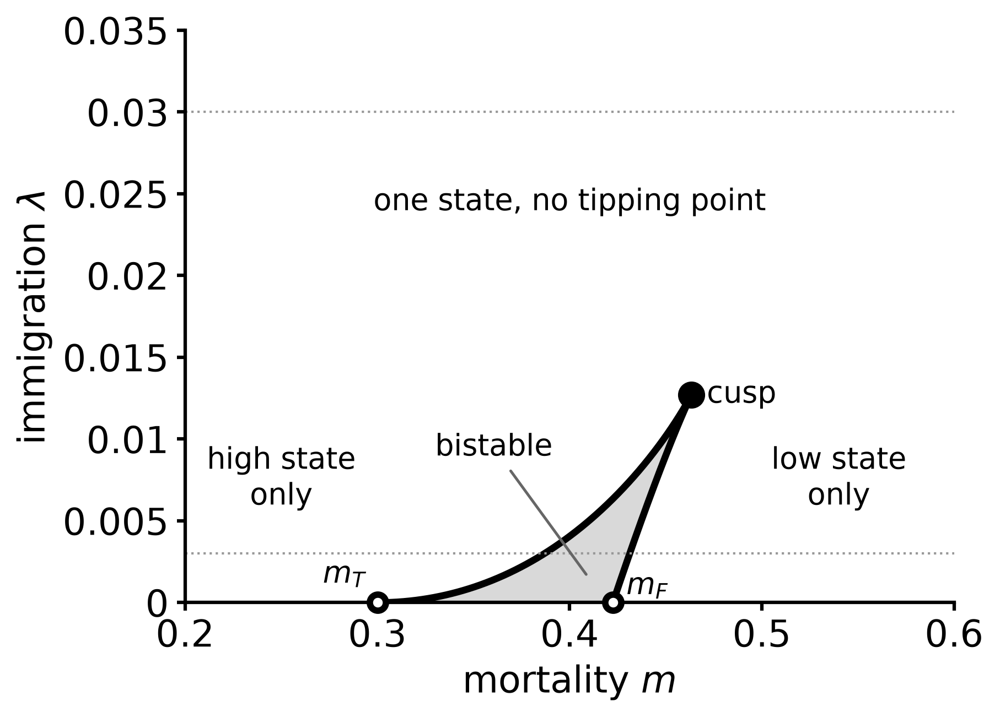

# Lecture 5. Limits to growth: cooperation and Allee effects

---

In [L4](l4.html#extinction) the only limit to growth is finite resources: any arbitrarily small population will grow to carrying capacity. This is quite general, as long as the growth rate is positive at all abundances below carrying capacity. In this case the growth rate has a negative density dependence (it decreases as abundance increases). In many scenarios it is possible to observe a positive density dependence.

## Positive density dependence

In many species individuals do better when there are more of them (mates are easier to find, groups defend better against predators, or hunt better, predators get satiated, microbes share what they secrete).

When the per-capita growth rate *increases* with density at low density, it is called an [Allee effect](https://en.wikipedia.org/wiki/Allee_effect) (Allee 1931; review: [Courchamp, Clutton-Brock & Grenfell 1999](https://doi.org/10.1016/s0169-5347(99)01683-3)).

Write $\dot N = N g(N)$ as in L4. There are three cases:

| per-capita rate $g(N)$          | name                                                         |
| ------------------------------- | ------------------------------------------------------------ |
| decreasing                      | no Allee effect (logistic)                                   |
| increasing at low $N$, $g(0)>0$ | *weak* Allee effect (same fixed-point behavior as the logistic) |
| increasing at low $N$, $g(0)<0$ | *strong* Allee effect: small populations decline             |

Microbes give clean examples. Yeast does not take up sucrose: it secretes invertase, which cuts sucrose into glucose and fructose *outside* the cell. Only about 1% of the products are captured by the cell that made them ([Gore, Youk & van Oudenaarden 2009](https://doi.org/10.1038/nature07921)), and the rest is a public good. The more cells there are, the more glucose there is in the medium, and the faster each cell grows.

The same shape appears across bacteria. [Lopes, Amor & Gore 2024](https://doi.org/10.1038/s41467-024-48521-9) measured the growth rate against the inoculum density.

## The simplest model

Verhulst took the simplest decreasing $g$, a straight line. The simplest $g$ with a hump is a parabola. 

$$
\frac{dN}{dt} = r N\,(N-a)\left(1-\frac{N}{N_{\max}}\right),
\qquad
g(N) = r (N-a)\left(1-\frac{N}{N_{\max}}\right).
$$

$r$ now has units of 1/(density × time). Measure $N$ in units of $N_{\max}$ and time in units of $1/(rN_{\max})$:

$$
u = \frac{N}{N_{\max}},\quad \alpha=\frac{a}{N_{\max}},\quad \tau = rN_{\max}t
$$
from which we get
$$
\frac{du}{d\tau} = u\,g(u) = u\,(u-\alpha)(1-u).
$$

One parameter is left: $\alpha$, the value of $u$ where $g$ changes sign (other than $u=1$). Since $g(0)=-\alpha$ and $g'(0)=1+\alpha$, it covers all three cases:

| $\alpha$ | $g(0)$ | $g'(0)$ | |
|---|---|---|---|
| $\alpha<-1$ | $>0$ | $<0$ | no Allee effect |
| $-1<\alpha<0$ | $>0$ | $>0$ | weak |
| $0<\alpha<1$ | $<0$ | $>0$ | strong ($u=\alpha$ is a threshold) |

The choice is less arbitrary than it looks. As we saw for the logistic, any function with the same zeros (fixed points) and the same signs has the same long-term behavior.

### Graphical solution

$f(u)=u\,(u-\alpha)(1-u)$ is a cubic, with zeros at $u^*=0$, $u^*=\alpha$ and $u^*=1$. The zero at $\alpha$ is a population only if $0<\alpha<1$.

Stability follows from L4, using $f'(u) = g(u) + u\,g'(u)$:

 $f'(0)=g(0)=-\alpha$: $u=0$ is unstable if $\alpha<0$ and stable if $\alpha>0$.

Nonzero fixed points.
There $g(u^*)=0$, so $f'(u^*) = u^*\,g'(u^*)$. It is stable where the per-capita curve decreases and unstable where it increases. The stability can be read directly off the plot of $g$.

  - $u^*=1$: $g'(1)=-(1-\alpha)<0$, so it is always stable.
  - $u^*=\alpha$: $g'(\alpha)=1-\alpha>0$, so it is unstable.

The three cases:

- No Allee effect ($\alpha<-1$). $g$ decreases from $g(0)>0$ to $g(1)=0$. Extinction is unstable and $u=1$ is stable: the logistic picture of [L4](l4.html).
- Weak ($-1<\alpha<0$). $g$ has a hump, but $g(0)>0$. Extinction is still unstable and $u=1$ stable: the same long-term behavior as the logistic. A weak Allee effect only slows down the initial growth. It is invisible in the fixed points.
- Strong ($0<\alpha<1$). $g(0)<0$. Extinction is stable, $u=\alpha$ is unstable, and $u=1$ is stable. The population is bistable: below the threshold $\alpha$ it goes extinct, above it it grows to $N_{\max}$. Where the population ends up depends on where it starts, not only on the parameters.

Moving $\alpha$ through $0$ is itself a transcritical bifurcation: $u^*=0$ and $u^*=\alpha$ cross, and since $f'(0)=-\alpha$ and $f'(\alpha)=\alpha(1-\alpha)$ have opposite signs, they exchange stability.

## The experiment, yeast on sucrose

**Setup.**

- *S. cerevisiae* in 2% sucrose ([Dai et al. 2012](https://doi.org/10.1126/science.1219805)).
- Every day a fraction $1/D$ of the culture is transferred into fresh medium.
- 8 dilution factors $D$ from 250 to 1600; for each, followed for a week.

**Dilution is mortality.** Let $n_t$ be the density at the end of day $t$. At the transfer it is divided by $D$, so the next day starts from $n_\mathrm{initial}=n_t/D$. During the day the culture grows by a factor $F$, which depends on the density it starts from, and it ends at $n_\mathrm{final}=n_{t+1}=n_\mathrm{initial}\,F(n_\mathrm{initial})$:

$$
n_{t+1} = \frac{n_t}{D}\,F\!\left(\frac{n_t}{D}\right)
\quad\Longrightarrow\quad
\ln\frac{n_{t+1}}{n_t} = \ln\frac{n_\mathrm{final}}{n_\mathrm{initial}} - \ln D .
$$

$\ln F=\ln(n_\mathrm{final}/n_\mathrm{initial})$ per day is the per-capita growth rate averaged over the day, and $\ln D$ per day is the mortality $\delta$. A fixed point needs $\ln(n_\mathrm{final}/n_\mathrm{initial}) = \ln D$, i.e. a net growth $\ln(n_{t+1}/n_t)=0$: the graphical method of [L4](l4.html). $D$ from 250 to 1600 means $\delta$ from 5.5 to 7.4 per day (0.23–0.31 /h).

*What the data show.* Each day is a batch culture started at $n_\mathrm{initial}$. Plotting $\ln(n_\mathrm{final}/n_\mathrm{initial})$ against $\log_{10} n_\mathrm{initial}$ therefore draws the per-capita curve itself. It is a hump, with its peak near $n_\mathrm{initial}\approx 2\times10^{-4}$ OD: the Allee effect, seen directly. Subtracting $\ln D$ gives the net growth, and the fixed points are where it crosses zero:

- $D=250$: the net growth is positive at every density below the stable state. There is no threshold, and extinction is unstable.
- $D=750$ to $1400$: two crossings, the threshold on the rising side of the hump and the stable state on the falling side. At $D=750$ the threshold is at the lowest density measured, and at $D=500$ it is below it.
- $D=1600$: the top of the hump just touches zero (+0.04). The fold is right there.

We therefore model $\ln F(n) = g(n)$ in our language and $\ln D = \delta$.

This simplification assumes that $F$ is independent of $D$. If this were true, the per-capita curves for different $D$ would coincide. They do not exactly: at the same starting density, the cultures at $D=1600$ grow 1.5–2.5× less per day than those at $D=250$. The cause is not known (carry-over of spent medium is one candidate). In the model this means $g$ itself depends weakly on $D$. We'll neglect this dependency.

## Changing mortality in Allee effect

Now add a mortality $\delta$, as at the end of L4:

$$
\frac{dN}{dt} = r N\,(N-a)\left(1-\frac{N}{N_{\max}}\right) - \delta N
$$
can be written as
$$
\ \frac{du}{d\tau} = u\,\bigl[g(u)-m\bigr] = u\,\bigl[(u-\alpha)(1-u)-m\bigr],\qquad m=\frac{\delta}{rN_{\max}}\ 
$$

The mortality only shifts the per-capita rate down by a constant. Graphically, the nonzero fixed points are where the per-capita curve crosses the horizontal line at height $m$, and raising $m$ moves the line up. Equivalently, they are where the net per-capita rate $g-m$ crosses zero, as in the Dai figure.

### Fixed points

$u^*=0$, and the solutions of $g(u^*)=m$. Completing the square:

$$
g(u) = m_F - (u-u_c)^2,\qquad u_c=\frac{1+\alpha}{2},\qquad m_F=\frac{(1-\alpha)^2}{4},
$$

so that

$$
u_\pm = u_c \pm \sqrt{m_F-m},
$$

Define $m_T\equiv-\alpha=g(0)$, so that
$u_+u_-=m-m_T$
and
$u_+ + u_-=1-m_T$

note that
$m_F-m_T=(1+\alpha)^2/4\ge0$
and therefore $m_F \ge m_T$, with equality only at $\alpha=-1$

At $m=0$ these are $u_+=1$ and $u_-=\alpha$.

### Feasibility (when do the fixed points exist)

Extinction, $u^*=0$, always exists. $u_\pm$ are populations only if they are real and positive.

- *Real* if $m\le m_F$. Above $m_F$ there is no solution $u_\pm$: the line is above the top of the hump, and extinction is the only fixed point.
- *Positive.* The product decides it. 
  - $m<m_T$: $u_+>0>u_-$. Only $u_+$ is a population.
  - $m_T<m\le m_F$: $u_+$ and $u_-$ have the same sign, that of their sum $1+\alpha$. Both are populations if $\alpha>-1$, neither if $\alpha<-1$.

### Stability

With $f(u)=u\,[g(u)-m]$, $f'(u)=g(u)-m+u\,g'(u)$.

- Extinction: $f'(0)=g(0)-m=m_T-m$. It is stable if and only if $m>m_T$.
- $u_\pm$: since $g(u_\pm)=m$, $f'(u_\pm)=u_\pm\,g'(u_\pm)$. With $g'(u)=-2(u-u_c)$,

$$
f'(u_\pm) = \mp\,2\,u_\pm\sqrt{m_F-m}.
$$

Whenever it is a population, $u_+$ is stable and $u_-$ is unstable. The rule is the same as without mortality: stable where $g$ decreases (the right side of the hump), unstable where it increases (the left side). $u_-$ is the threshold: populations starting below it go extinct.

### Summary

| fixed point       | value              | is feasible ($u^* \geq 0$) when                | $f'(u^*)$           | stable     |
| ----------------- | ------------------ | ---------------------------------------------- | ------------------- | ---------- |
| extinction        | $0$                | always                                         | $m_T-m$             | if $m>m_T$ |
| $u_+$             | $u_c+\sqrt{m_F-m}$ | $m<m_F$ if $\alpha>-1$; $m<m_T$ if $\alpha<-1$ | $-2u_+\sqrt{m_F-m}$ | always     |
| $u_-$ (threshold) | $u_c-\sqrt{m_F-m}$ | $m_T<m<m_F$ and $\alpha>-1$                    | $+2u_-\sqrt{m_F-m}$ | never      |

with $u_c=(1+\alpha)/2$, $m_T=-\alpha$ and $m_F=(1-\alpha)^2/4$.

### Two bifurcations

Increase $m$ and follow the fixed points.

- Transcritical at $m_T = -\alpha$, i.e. where the line passes through $g(0)$. $u_-$ (or $u_+$, if $\alpha<-1$) crosses zero and exchanges stability with extinction. This is the bifurcation of L4.
- Fold (saddle-node) at $m_F$, where the line is tangent to the top of the hump. $u_+$ and $u_-$ collide at $u_c$ and annihilate. Beyond it, extinction is the only state.

What happens depends on $\alpha$:

- No Allee effect ($\alpha<-1$). The top of the hump is at $u_c<0$. Only the transcritical is reached, and the extinction is continuous, as in L4.
- Weak ($-1<\alpha<0$). There are three regimes:
  - $m<-\alpha$: only survival is stable;
  - $-\alpha<m<m_F$: the population is *bistable*, between survival and extinction;
  - $m>m_F$: only extinction.
- *Strong ($0<\alpha<1$).* Extinction is stable for every $m\ge0$, and the population is bistable for $m<m_F$.

> [!figure] Allee effect with mortality: transcritical, fold and hysteresis
> Move the mortality $m$ in the weak case, $\alpha=-0.3$, and follow the three pictures together: the flow on the line, the per-capita rate, and the fixed points as a function of $m$ (the bifurcation diagram). Between $m_T=0.3$ and $m_F=0.4225$ the population is bistable. Past $m_F$ it collapses, and it comes back only below $m_T$.
>
> <iframe class="widget" src="material/l5-allee-mortality.html" title="L5-allee-mortality" loading="lazy" style="display:block;width:100%;height:520px;border:0;margin:.6rem 0"></iframe>

### Catastrophe and hysteresis

At $m_F$ the population does not shrink to zero: it jumps from $u_c=(1+\alpha)/2$ to $0$. Just before the jump, $u_+ = u_c+\sqrt{m_F-m}$ declines with infinite slope, but far from the fold it barely moves.

Going back is harder:

- Weak Allee effect. A collapsed population regrows from a few survivors only when $m<-\alpha$. The hysteresis loop has width $m_F-m_T=(1+\alpha)^2/4$.
- Strong Allee effect. Lowering the mortality never brings it back. Individuals have to be reintroduced above $u_-$.

Compare with L4:

| | logistic + $\delta$ | Allee + $\delta$ |
|---|---|---|
| bifurcation | transcritical | fold (plus a transcritical if weak) |
| density at the threshold | $\to 0$ | $u_c>0$: a jump |
| undoing it | reduce $\delta$ just below $\delta_c$ | reduce $\delta$ below $m_T$, or reintroduce |

### Normal form

Near the fold write $x=u-u_c$ and $\epsilon = m_F-m$. Then $g-m=\epsilon-x^2$, and to leading order

$$
\frac{dx}{d\tau} \simeq u_c\,(\epsilon - x^2) .
$$

This is the normal form of the saddle-node (Strogatz 3.1). Any per-capita curve with a smooth maximum, pushed down by mortality, gives this equation near its top. The square roots above follow from it.

## Immigration: two folds and a cusp

So far the population was isolated. Real populations usually receive immigrants: from a mainland, from a source population nearby, or, in the lab, one could add a fixed number of cells at every transfer. We can add a constant flux $L$ of immigrants per unit volume and time:

$$
\frac{dN}{dt} = N\,\bigl[g(N)-\delta\bigr] + L
$$
In rescaled variables we obtain
$$
\ \frac{du}{d\tau} = u\,\bigl[(u-\alpha)(1-u)-m\bigr] + \lambda \ , \ \ \text{with} \ \
 \lambda = \frac{L}{rN_{\max}^2}.
$$

With $\lambda>0$, $u=0$ is no longer a fixed point, since $\dot u(0)=\lambda>0$. Expanded, the right-hand side is a cubic,

$$
f(u) = -u^3 + (1+\alpha)\,u^2 - (\alpha+m)\,u + \lambda .
$$

### Graphical solution

Divide by $u$. The fixed points are where

$$
G(u) \equiv (u-\alpha)(1-u) + \frac{\lambda}{u} = m ,
$$

and since $f = u\,(G(u)-m)$, at a fixed point $f'(u^*)=u^*G'(u^*)$. As before a fixed point is stable where $G'(u^*)$ is negative and unstable where it is positive.

> [!figure] Graphical solution with immigration
> Move $m$ and $\lambda$, at $\alpha=-0.3$. The fixed points are where $G(u)$ crosses the line at height $m$: stable where $G$ decreases, unstable where it increases. The small black dots are the minimum and the maximum of $G$.
>
> <iframe class="widget" src="material/l5-immigration-g.html" title="L5-immigration-G" loading="lazy" style="display:block;width:100%;height:520px;border:0;margin:.6rem 0"></iframe>

How many times the line at height $m$ crosses $G$ depends on whether $G$ has a minimum and a maximum, and on where $m$ sits relative to them. These are the extrema of the function $G$, where $G'(u)=0$. When $m$ passes through an extremum, the line is tangent to $G$ and two fixed points are created or destroyed: these are the bifurcation lines explained below. The extrema solve

$$
G'(u) = 1+\alpha-2u-\frac{\lambda}{u^2} = 0
\quad\Longleftrightarrow\quad
\lambda = u^2(1+\alpha-2u).
$$

The right-hand side vanishes at $u=0$ and $u=(1+\alpha)/2 \equiv u_c$. The right hand side has its maximum (for positive $u$) at
$$
0=2 u(1+\alpha-2 u) -2 u^2 = - 6 u^2 + 2 u (1+\alpha) =- 2 u (3 u - (1+\alpha))
$$

 $u=(1+\alpha)/3$. Therefore 
$$
\max_{u > 0} \left(u^2(1+\alpha-2u) \right) = \frac{(1+\alpha)^3}{27} \equiv \lambda_c
$$

- **$\lambda<\lambda_c$.** $G$ has a minimum at $u_1$ and a maximum at $u_2$. A line $m$ between $G(u_1)$ and $G(u_2)$ crosses $G$ three times, producing 3 fixed points (2 stable and one unstable).
- **$\lambda>\lambda_c$.** $G$ is monotonically decreasing. There is one fixed point for every $m$.

This is the same as the spruce budworm picture (Strogatz 3.7). 

### The bifurcation points (fold lines)

A fold is a fixed point with zero slope: $f=0$ and $f'=0$, i.e. $m=G(u)$ and $G'(u)=0$. 

We have
$$
m = G(u) = (u-\alpha)(1-u) + \frac{\lambda}{u} .
$$
and from $G'(u)=0$ we obtain
$$
\lambda = u^2((1+\alpha)-2u),\qquad
$$
Since $\lambda \geq 0$, the last equation should be considered with $0 \leq u \leq (1+\alpha)/2 = u_c$

These two equations define two curves in the $(m,\lambda)$ plane. Substituting the second equation into the first, we obtain
$$
m = (u-\alpha)(1-u) + u(1+\alpha - 2 u) = - 3 u^2 + 2(1+\alpha) u - \alpha
$$
which should be taken together
$$
\lambda = u^2((1+\alpha)-2u),\qquad
$$
for
$0 \leq u \leq (1+\alpha)/2 = u_c$

For $u\to0$ we obtain $(m,\lambda)\to(-\alpha,0)=(m_T,0)$
when $u \approx 0$ we have
$m \approx m_T +2 (1+\alpha) u$
$$\lambda \approx (1+\alpha) u^2 \approx  \frac{(m-m_T)^2}{4 (1+\alpha)}$$

For $u \to u_c$ we have $(m,\lambda)\to(m_F,0)$
when $u \approx u_c$ we have
$$
m \approx m_F + (1+\alpha)(u_c-u) = m_F + 2u_c\,(u_c-u)
$$
$$
\lambda \approx 2 u_c^2 \left( u_c - u \right) \approx u_c\,(m-m_F)
$$

The maximum value of $\lambda$ with a solution is obtained when $u^2((1+\alpha)-2u)$ is maximized. This is obtained at $u = 2 u_c/3$ with a maximum $\lambda_c = (1+\alpha)^3/27$

Similarly the max value of $m$ with a solution is obtained by maximizing $- 3 u^2 + 2(1+\alpha) u - \alpha$, which has a maximum also at $u = 2 u_c/3$, corresponding to $m_c = G(2 u_c / 3) = \frac{(1+\alpha)^2}{3} - \alpha$.
One can check that $m_c > m_F \ge m_T$: $m_c-m_F=(1+\alpha)^2/12$ and $m_F-m_T=(1+\alpha)^2/4$.

The two maxima are at the same $u$ for a reason that does not depend on the shape of $g$. On a fold line $m=G(u,\lambda)$ and $\partial G/\partial u=0$, so along the line
$$
\frac{dm}{du}=\frac{\partial G}{\partial \lambda}\,\frac{d\lambda}{du}=\frac{1}{u}\,\frac{d\lambda}{du}
\qquad\Longrightarrow\qquad
\frac{d\lambda}{dm}=u .
$$
The slope of a fold line in the $(m,\lambda)$ plane is the density at the fold, so $dm/du$ and $d\lambda/du$ vanish together. This also gives the shape of the lines: the lower fold leaves $(m_T,0)$ horizontally ($u\to0$), the upper fold leaves $(m_F,0)$ with slope $u_c$, and both arrive at the cusp with the same slope $2u_c/3$.

Joining the dots we obtain

> [!figure] Fold lines and the cusp
> The two fold lines in the $(m,\lambda)$ plane, at $\alpha=-0.3$. They start on the axis $\lambda=0$ at $m_T=0.3$ and $m_F=0.4225$ and meet at the cusp, $(m_c,\lambda_c)=(0.463,\,0.0127)$. Inside (grey) the population is bistable, between the refuge and the high state. The dotted lines are $\lambda=0.003$ and $\lambda=0.03$.
>
> 

The point $(m_c,\lambda_c)$, where the two fold lines meet tangentially, is called a *cusp*.

 Above $\lambda_c$, increasing the mortality lowers the population smoothly and reversibly. Enough immigration removes the tipping point altogether.

> [!figure] Phase diagram with immigration: two folds and a cusp
> Drag the point in the $(m,\lambda)$ plane, at $\alpha=-0.3$. Inside the region bounded by the two fold lines the population is bistable, between the refuge and the high state. The other two panels show the graphical solution, $G(u)=m$, as in the $G(u)$ figure above, and the flow on the line. Follow the region down to $\lambda=0$, where it ends between $m_T$ and $m_F$, and up to the cusp, above which there is a single state.
>
> <iframe class="widget" src="material/l5-immigration-phase.html" title="L5-immigration-phase" loading="lazy" style="display:block;width:100%;height:520px;border:0;margin:.6rem 0"></iframe>

## Normal form of the cusp and the potential

Shift to the inflection point of $f$. Since $f''(u)=-6u+2(1+\alpha)$, it is at $u_*=(1+\alpha)/3=2u_c/3$, the position of the cusp. Write $u=u_*+x$ and use $1+\alpha=3u_*$:

$$
f = -(u_*+x)^3 + 3u_*(u_*+x)^2 - (\alpha+m)(u_*+x) + \lambda .
$$

The terms in $x^2$ cancel ($-3u_*x^2+3u_*x^2$), and what is left is

$$
\frac{dx}{d\tau} = -x^3 + J\,x + H,
$$
where
$$
J = 3u_*^2-\alpha-m = m_c-m,
$$
and
$$
H = \lambda + 2u_*^3-(\alpha+m)\,u_* = (\lambda-\lambda_c) + u_*\,J ,
$$

using $m_c=3u_*^2-\alpha$ and $\lambda_c=u_*^3$. This is exact, not an expansion as $f$ is a cubic. $(J,H)$ is just a change of coordinates of $(m,\lambda)$.

*The potential.* 
We can always write
$$
\frac{d x}{dt}= f(x) = -\frac{dV}{dx}
$$
where $V(x) = - \int^x dz\, f(z)$.

If we write
$$
\frac{dV}{dt} = \frac{dV}{dx} \frac{dx}{dt} = - \left( \frac{dV}{dx} \right)^2 \leq 0
$$

so $V$ can only decrease. 

The condition of fixed point $f(x) = 0$ corresponds to $dV/dx = 0$ (fixed points are extrema of $V$).
The condition $f'(x) < 0$ corresponds to $d^2V/dx^2 > 0$ (stable fixed points are minima of $V$ and unstable fixed points are maxima).

In our case we have a quartic potential

$$
V(x) = \frac{x^4}{4} - J\,\frac{x^2}{2} - H\,x .
$$

 

> [!figure] The cusp potential
> Move $J$ and $H$, or drag the point in the $(J,H)$ plane. Inside the region bounded by the fold lines $H=\pm2(J/3)^{3/2}$ the potential has two wells (two stable fixed points, separated by an unstable one); outside it has one. At $H=0$, moving $J$ through 0 splits one minimum into two. At $J>0$, moving $H$ tilts the double well until one minimum merges with the maximum and disappears: a fold.
>
> <iframe class="widget" src="material/l5-potential.html" title="L5-potential" loading="lazy" style="display:block;width:100%;height:520px;border:0;margin:.6rem 0"></iframe>

This is mean-field Ising, i.e. Landau theory: $x$ is the magnetization, $J\propto T_c-T$, $H$ is the external field, and $V$ is the free energy. The cusp is the critical point, the fold lines are the spinodals, and the hysteresis loop is the one of a magnet.

## Exercises

1. For $\dot N = N\,[g(N)-\delta]$, show that a nonzero fixed point is stable if and only if $g'(N^*)<0$, whatever the shape of $g$.
2. For $g(u)=(u-\alpha)(1-u)$:
   - find the ranges of $\alpha$ with no, weak and strong Allee effect;
   - compute $m_T$, $m_F$, $u_\pm$;
   - show that the fold line and the transcritical line are tangent at $\alpha=-1$.
3. Derive the normal form near $(u_c,m_F)$. Show that the recovery rate and the basin width both scale as $\sqrt{m_F-m}$, and that their ratio is $u_+$.
4. (Colab) Take $\alpha=-0.3$. Increase $m$ slowly from 0 past $m_F$, then decrease it back to 0, starting from a small nonzero $u$ each time it collapses. Plot $u$ against $m$ and find the hysteresis loop. What changes if $u$ is set exactly to zero after the collapse?
5. A public good. A cooperative species secretes a product $G$ that decays at rate $\gamma$, with $\dot G = kN-\gamma G$. Assume the product is fast, and that growth is $\bigl[b_0 + b_1\phi(G)\bigr](1-N/N_{\max})$, with $\phi$ the Monod function of L4.
   - Show that the per-capita rate has a weak Allee effect.
   - What sets $g(0)$? What happens when $b_0=0$?
6. Dai et al.: from $\ln(n_\mathrm{final}/n_\mathrm{initial})-\ln D$ against $\log_{10} n_\mathrm{initial}$ (data in the course folder), read off the fixed points for each $D$ as the zero crossings. Convert them to end-of-day densities, $n^*=D\,n_\mathrm{initial}^*$, and compare them with the trajectories.
7. Immigration:
   - derive the parametric fold lines $(m(u),\lambda(u))$ and the cusp;
   - show that for small $\lambda$ the lower fold moves as $m_T+2\sqrt{(1+\alpha)\lambda}$ and the upper one as $m_F+2\lambda/(1+\alpha)$;
   - what does this imply for restoring a collapsed population by adding immigrants?
8. The spruce budworm (Strogatz 3.7), $\dot x = rx(1-x/k) - x^2/(1+x^2)$.
   - Write the per-capita rate and identify which term plays the role of $\lambda/u$ and which the role of the Allee hump.
   - Find the cusp, at $(k,r)=(3\sqrt3,\,3\sqrt3/8)$.

## At home

- Strogatz 3.1–3.2 (saddle-node, transcritical, normal forms), 3.6 (imperfect bifurcations and the cusp), and 3.7 (the spruce budworm: the same two folds and cusp as the immigration model, with predation instead of immigration).
- [Scheffer et al. 2009](https://doi.org/10.1038/nature08227), early-warning signals for critical transitions.
- [Dai, Korolev & Gore 2013](https://doi.org/10.1038/nature12071): the same yeast in connected populations, with warnings in space.
- Dai, Korolev & Gore 2015 compare a mortality driver with a nutrient driver, and show that the relation between stability and resilience depends on the driver.
- [Drake & Griffen 2010](https://doi.org/10.1038/nature09389): slowing down before a *transcritical* extinction in *Daphnia*.

## References

- W. C. Allee, *Animal Aggregations* (1931).
- C. S. Holling, [Resilience and stability of ecological systems](https://doi.org/10.1146/annurev.es.04.110173.000245), *Annu. Rev. Ecol. Syst.* **4**, 1 (1973).
- F. Courchamp, T. Clutton-Brock, B. Grenfell, [Inverse density dependence and the Allee effect](https://doi.org/10.1016/s0169-5347(99)01683-3), *Trends Ecol. Evol.* **14**, 405 (1999).
- J. Gore, H. Youk, A. van Oudenaarden, [Snowdrift game dynamics and facultative cheating in yeast](https://doi.org/10.1038/nature07921), *Nature* **459**, 253 (2009).
- M. Scheffer et al., [Early-warning signals for critical transitions](https://doi.org/10.1038/nature08227), *Nature* **461**, 53 (2009).
- J. M. Drake, B. D. Griffen, [Early warning signals of extinction in deteriorating environments](https://doi.org/10.1038/nature09389), *Nature* **467**, 456 (2010).
- L. Dai, D. Vorselen, K. S. Korolev, J. Gore, [Generic indicators for loss of resilience before a tipping point leading to population collapse](https://doi.org/10.1126/science.1219805), *Science* **336**, 1175 (2012); data: [Dryad 10.5061/dryad.p2481134](https://doi.org/10.5061/dryad.p2481134).
- L. Dai, K. S. Korolev, J. Gore, [Slower recovery in space before collapse of connected populations](https://doi.org/10.1038/nature12071), *Nature* **496**, 355 (2013).
- L. Dai, K. S. Korolev, J. Gore, [Relation between stability and resilience determines the performance of early warning signals under different environmental drivers](https://doi.org/10.1073/pnas.1418415112), *PNAS* **112**, 10056 (2015).
- W. Lopes, D. R. Amor, J. Gore, [Cooperative growth in microbial communities is a driver of multistability](https://doi.org/10.1038/s41467-024-48521-9), *Nat. Commun.* **15**, 4709 (2024).
- S. H. Strogatz, *Nonlinear Dynamics and Chaos*, ch. 3.
