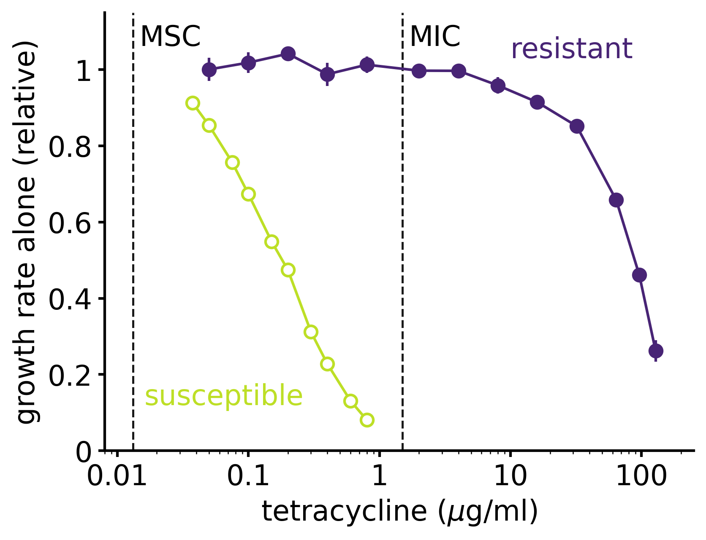
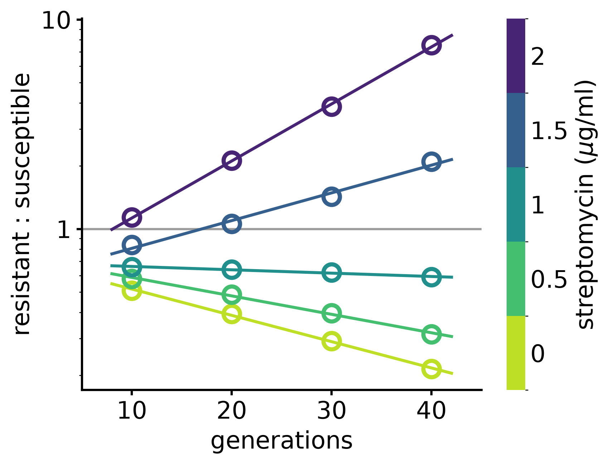
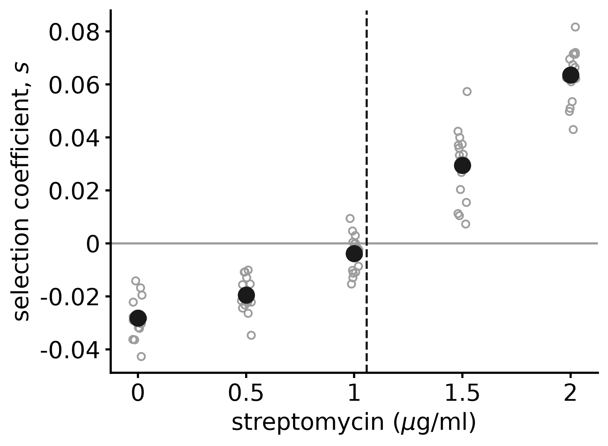
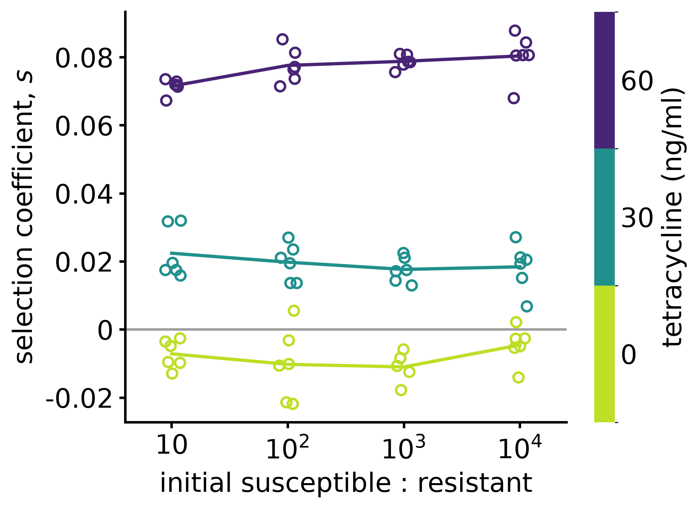

# Lecture 7. Selection

---

In [L6](l6.html) we put two species in the same tube and asked who wins. Evolution asks the same question about individuals of the same species that differ in a heritable trait, like the resistant mutants of [L3](l3.html). If one type leaves more offspring than another, its frequency in the population increases. This is selection.

What evolution is, and how we know it happens, is in [L8](l8.html). Here we describe selection in the simplest setting: types that do not change (no mutations), in populations so large that we can neglect demographic noise ([L2](l2.html)). Noise comes back in L9, where we ask whether a single new mutant takes over.

## Resistant and susceptible in the same tube

When does an antibiotic select for resistance? [Gullberg et al. 2011](https://doi.org/10.1371/journal.ppat.1002158) put a resistant and a susceptible strain together, at antibiotic concentrations below the one that stops the growth of the susceptible strain (the MIC, minimal inhibitory concentration).

**Each strain alone.** The growth rate of the susceptible strain falls as the concentration increases, and it stops growing at the MIC. A resistant strain grows almost unaffected up to ten times the MIC, and stops only near a hundred times it. In the figure the resistant strain carries Tn10dTet, a gene for an efflux pump that exports tetracycline out of the cell. What happens when the two are together?

> [!figure] Each strain alone
> Growth rate of each strain grown alone, relative to its own rate without antibiotic, vs tetracycline (log scale): susceptible *Salmonella* (open) and the same strain carrying Tn10dTet (filled), mean ± SEM (Gullberg et al. 2011, Table S2, their Fig. 1B). Dashed lines: the MIC of the susceptible strain, 1.5 µg/ml, and the MSC measured in competition (below), 13 ng/ml. Without antibiotic the resistant strain alone grows slightly faster, 1.86 against 1.73 per hour, yet in competition it loses: the growth rate alone does not predict the outcome.
>
> 

**Setup.**

- Pairs of strains of *E. coli* and *Salmonella* Typhimurium that differ by one resistance mutation, each tagged with a different fluorescent protein. For instance *rpsL* K42R for streptomycin (a mutation in a ribosomal protein, the drug's target), Tn10dTet for tetracycline (the efflux pump above), *gyrA* S83L for ciprofloxacin.
- The two strains are mixed and grown in serial transfer: every 24 hours the culture is diluted 1000-fold into fresh medium with the same antibiotic concentration. About 10 generations per transfer.
- At every transfer, the ratio $R$ of resistant to susceptible cells is measured by flow cytometry, counting $10^5$ cells. Two strains can be told apart by colour. With many strains one uses DNA barcodes counted by sequencing, as in the modern Luria–Delbrück experiment of [L3](l3.html#moments). In evolution experiments, where the types are not known in advance, whole genomes are sequenced.

**What the data show.** $\ln R$ changes linearly with the number of generations. The slope depends on the antibiotic concentration. Without antibiotic it is negative: resistance has a cost, a slope of $-0.03$ per generation for the streptomycin mutation. It becomes positive above a *minimal selective concentration* (MSC). For streptomycin the MSC is 1 µg/ml, a quarter of the MIC of the susceptible strain. For the other mutations it is between 1/10 and 1/230 of the MIC. Resistance is selected at concentrations far below those that stop the growth of the susceptible cells.

The sign of selection is not a property of the mutation. The same mutation is costly without the drug and favoured with it: fitness is a property of a type *in an environment*. Here the environment is fixed from outside. When the types change it themselves, fitness and environment change together: this is eco-evolutionary dynamics, at the end of the course. The plates of Luria and Delbrück ([L3](l3.html)) were far above the MIC, where susceptible cells do not grow at all and any resistant colony is selected. Here, below the MIC, both types grow, and selection is a difference of growth rates.

> [!figure] Resistant and susceptible in the same tube
> Ratio of resistant (*rpsL* K42R) to susceptible *Salmonella* vs generations, at five streptomycin concentrations, one competition each (digitized from Gullberg et al. 2011, Fig. 2A). Lines are straight-line fits of $\ln R$.
>
> 

> [!figure] Selection and antibiotic concentration
> Slope of $\ln R$ per generation for each competition (grey) and their mean (black), vs streptomycin concentration (Gullberg et al. 2011, Table S3). The dashed line is the MSC. The MIC of the susceptible strain is 4 µg/ml.
>
> 

We want to understand why $\ln R$ is linear in time, what its slope is, and why the slope does not depend on how the total population grows.

## Two types growing exponentially

Let's consider two types, $A$ and $a$, growing exponentially as in [L1](l1.html):

$$
\frac{dn_A}{dt} = f_A\,n_A,\qquad \frac{dn_a}{dt} = f_a\,n_a .
$$

$f_i$ is the per-capita growth rate of type $i$. We call it the *fitness* of type $i$. The total population is $N=n_A+n_a$ and the frequency of $A$ is $x=n_A/N$. Then

$$
\frac{dx}{dt} = \frac1N\frac{dn_A}{dt}-\frac{n_A}{N^2}\frac{dN}{dt}
= f_A\,x - x\,\bigl(f_A\,x+f_a\,(1-x)\bigr),
$$

from which we get

$$
\boxed{\ \frac{dx}{dt} = s\,x(1-x),\qquad s=f_A-f_a\ }
$$

$s$ is the *selection coefficient*. It is the logistic equation of [L4](l4.html), now for a frequency. The "carrying capacity" $x=1$ does not come from resources, but from the definition of a frequency. The fixed points are $x=0$ and $x=1$. If $s>0$, $x=1$ is stable and $x=0$ is unstable: $A$ takes over. If $s<0$, the opposite.

The solution is the logistic of L4:

$$
x(t)=\frac{x_0\,e^{st}}{1-x_0+x_0\,e^{st}} ,
$$

which can be written as

$$
\ln\frac{x(t)}{1-x(t)} = \ln\frac{x_0}{1-x_0} + s\,t .
$$

This is just the ratio of two exponentials, $n_A/n_a = (n_A(0)/n_a(0))\,e^{(f_A-f_a)t}$. The log of the ratio is linear in time and its slope is the selection coefficient, as in the data. Only the difference of the growth rates matters. Both types could be declining ($f_A,f_a<0$): if $f_A>f_a$, $A$ still increases in frequency.

The slope does not depend on the frequency. Gullberg et al. also started the tetracycline competitions with one resistant cell every 10, up to one every $10^4$. The slope barely changes.

> [!figure] The slope does not depend on the starting frequency
> Selection coefficient of a tetracycline-resistant strain vs the initial ratio susceptible : resistant, at three tetracycline concentrations (Gullberg et al. 2011, Table S3).
>
> 

When $A$ is rare, $x\simeq x_0e^{st}$: it grows exponentially at rate $s$. The time to go from a single individual, $x=1/N$, to $x=1-1/N$ is

$$
t_{\rm sweep}=\frac{2\ln(N-1)}{s}\simeq\frac{2\ln N}{s}.
$$

With $N=10^9$ and $s=10^{-2}$ per generation, about 4000 generations. A *selective sweep* is slow, and its duration depends on $N$ only through a logarithm.

## Limits to growth

Cells cannot grow exponentially forever ([L4](l4.html)). Suppose that limitation of resources reduces growth equally to every type, $\dot n_i=n_i\,(f_i-cN)$. The per-capita rates still differ by $f_A-f_a$, and the frequency follows exactly the same equation, $\dot x=s\,x(1-x)$. The total population goes to its carrying capacity, and selection goes on there.

In general, write the per-capita growth rate of type $i$ as $g_i$, which can depend on all the densities, $\dot n_i=n_i\,g_i$. The same steps as above give

$$
\frac{dx_i}{dt}=\frac1N\frac{dn_i}{dt}-\frac{n_i}{N^2}\frac{dN}{dt}=x_i\,(g_i-\bar g),\qquad \bar g=\sum_j x_j\,g_j=\frac1N\frac{dN}{dt}.
$$

This is exact. Whatever is added to all the $g_i$ cancels: what matters for the frequencies is the difference of the per-capita growth rates. Selection is constant when the differences are constant. When they depend on the frequencies, selection is *frequency-dependent* ([below](#frequency-dependent-selection)).

If the differences depend on the total density, the frequencies are coupled to $N$. Take two types that also differ in how much crowding slows them, $\dot n_i=n_i\,(f_i-c_iN)$. Then

$$
\frac{dx}{dt}=x(1-x)\,\bigl[(f_A-f_a)-(c_A-c_a)\,N\bigr].
$$

The key is a separation of time scales. If the two types are similar, $x$ changes slowly, while $N$ relaxes at rate $\bar f$ to the value where the population stops growing, $\bar g=0$, i.e. $N^*=\bar f/\bar c$ with $\bar c=\sum_ix_ic_i$. Setting $N=N^*$ closes the equation for the frequency:

$$
\frac{dx}{dt}=\frac{c_Ac_a}{\bar c}\,(K_A-K_a)\,x(1-x),\qquad K_i=\frac{f_i}{c_i}.
$$

Once the population has saturated, the type with the larger carrying capacity wins, not the one that grows faster (exercise 7). The same reduction holds for arbitrary forms of self-limitation and competition ([Mazzolini & Grilli 2023](https://doi.org/10.1103/PhysRevE.108.034406)). In the rest of this note the differences of the $g_i$ do not depend on $N$.

## Many types, the replicator equation

With $S$ types, $\dot n_i=f_i\,n_i$ and $x_i=n_i/N$, the same steps give

$$
\boxed{\ \frac{dx_i}{dt}=x_i\,\bigl(f_i-\bar f\bigr),\qquad \bar f=\sum_j f_j\,x_j\ }
$$

the *replicator equation* ([Taylor & Jonker 1978](https://doi.org/10.1016/0025-5564(78)90077-9); [Schuster & Sigmund 1983](https://doi.org/10.1016/0022-5193(83)90445-9)). $\bar f$ is the *mean fitness*, $\bar{f} = \sum_i f_i x_i$
A type grows in frequency if it is fitter than the average.

### Fixed points

Each type is either absent, $x_i=0$, or has $f_i=\bar f$. If all the $f_i$ are different, only one type can be present. There are $S$ fixed points, one per type: $x_j=1$ and $x_i=0$ for $i\ne j$.

### Stability

At the fixed point where $j$ is alone, $\bar f=f_j$, and a rare type $i$ grows as

$$
\frac{dx_i}{dt}\simeq(f_i-f_j)\,x_i .
$$

$f_i-f_j$ is the invasion rate of $i$ into $j$, as in [L6](l6.html#one-species-alone). The fixed point is stable if no type can invade, i.e. if $f_j$ is the largest fitness. Only one fixed point is stable: the fittest type, provided it is present at the start (without mutations, a type that is absent stays absent).

### Solution

The solution is explicit:

$$
x_i(t)=\frac{x_i(0)\,e^{f_it}}{Z(t)},\qquad Z(t)=\sum_jx_j(0)\,e^{f_jt}=\frac{N(t)}{N(0)} .
$$

It has the form of a Boltzmann distribution, with $-f_i$ in the role of the energy and $t$ in the role of the inverse temperature. Selection is a cooling: for $t\to\infty$ the population condenses on the "ground state", the fittest type. The mean fitness is $\bar f=d\ln Z/dt$, as the mean energy is $-\partial\ln Z/\partial\beta$.

## Fisher's fundamental theorem

How does the mean fitness change? Using the replicator equation,

$$
\frac{d\bar f}{dt}=\sum_if_i\,\frac{dx_i}{dt}=\sum_if_i^2\,x_i-\bar f\sum_if_i\,x_i ,
$$

which can be written as

$$
\boxed{\ \frac{d\bar f}{dt}=\overline{f^2}-\bar f^{\,2}=\mathrm{Var}(f)\ }
$$

The mean fitness increases at a rate equal to the variance of fitness in the population (Fisher 1930). In the language of the solution, $\mathrm{Var}(f)=d^2\ln Z/dt^2$, the analogue of the heat capacity.

- The mean fitness never decreases, and it stops increasing when there is no variance left.
- Selection consumes the variation it feeds on. The variance itself changes as $d\,\mathrm{Var}(f)/dt=\kappa_3$, the third cumulant of the fitness distribution. In general $d\kappa_n/dt=\kappa_{n+1}$, because $\ln Z(t+\lambda)-\ln Z(t)$ is the cumulant generating function of the fitness distribution at time $t$. Without a source of new variation (mutations, [L3](l3.html)) evolution stops. How fast a population adapts when mutations keep supplying variance is the subject of L10.
- It is a seductive result, but neither fundamental nor a theorem in general. It holds for constant fitness. Fisher's own statement is about the additive genetic variance in sexual populations, and [Price 1972](https://doi.org/10.1111/j.1469-1809.1972.tb00764.x) showed that it describes only the part of the change of $\bar f$ due to the change in frequencies.

## Price equation

Fitness is not something we can see on an organism. What we can measure is a trait: beak depth, cell size, the concentration of antibiotic a cell tolerates. Let $q_i$ be the value of the trait of type $i$ and $\bar q=\sum_iq_ix_i$ its mean. Using the replicator equation,

$$
\frac{d\bar q}{dt}=\sum_iq_i\,x_i\,(f_i-\bar f)=\overline{qf}-\bar q\,\bar f ,
$$

that is

$$
\boxed{\ \frac{d\bar q}{dt}=\mathrm{Cov}(q,f)\ }
$$

the *Price equation* ([Price 1970](https://doi.org/10.1038/227520a0)). A trait changes if it covaries with fitness, whatever the reason for the covariance. Fisher's theorem is the special case $q=f$. Price's general version has a second term, the average change of the trait between parent and offspring. Here it is zero, because each type reproduces itself exactly.

## Frequency-dependent selection

So far the fitness of a type did not depend on the others. Often it does: the advantage of a cheater depends on how many cooperators are around. With two types,

$$
\frac{dx}{dt}=x(1-x)\,\bigl[f_A(x)-f_a(x)\bigr] .
$$

### Fixed points

$x=0$, $x=1$, and any $x^*$ where $f_A(x^*)=f_a(x^*)$: both types grow at the same rate.

### Feasibility (when does the mixed point exist)

$x^*$ is a population with both types only if $0<x^*<1$.

### Stability

- At $x=0$, $\dot x\simeq[f_A(0)-f_a(0)]\,x$: $x=0$ is unstable if $A$ can invade $a$ when rare.
- At $x=1$, in the same way, $x=1$ is unstable if $a$ can invade $A$ when rare, $f_a(1)>f_A(1)$.
- At $x^*$, $x^*$ is stable if $f_A-f_a$ decreases with $x$ there: the rarer type is the fitter one (*negative frequency dependence*).

### Linear frequency dependence

The simplest case is a fitness that depends linearly on the frequencies, as if it were the sum of the effects of encounters with other individuals (a *game*). Call $P_{ij}$ the gain of an individual of type $i$ meeting one of type $j$:

$$
f_A(x)=P_{AA}\,x+P_{Aa}\,(1-x),\qquad f_a(x)=P_{aA}\,x+P_{aa}\,(1-x).
$$

The two invasion rates are

$$
\lambda_{A|a}=f_A(0)-f_a(0)=P_{Aa}-P_{aa},\qquad \lambda_{a|A}=f_a(1)-f_A(1)=P_{aA}-P_{AA},
$$

and $f_A-f_a=\lambda_{A|a}-(\lambda_{A|a}+\lambda_{a|A})\,x$. Then

$$
x^*=\frac{\lambda_{A|a}}{\lambda_{A|a}+\lambda_{a|A}},
$$

and the slope of $f_A-f_a$ at $x^*$ is $-(\lambda_{A|a}+\lambda_{a|A})$.

### Summary

| | $\lambda_{A\vert a}$ | $\lambda_{a\vert A}$ | $0<x^*<1$ | stable | outcome |
| --- | --- | --- | --- | --- | --- |
| 1 | $>0$ | $<0$ | no | $x=1$ | $A$ wins |
| 2 | $<0$ | $>0$ | no | $x=0$ | $a$ wins |
| 3 | $>0$ | $>0$ | yes | $x^*$ | stable coexistence (polymorphism) |
| 4 | $<0$ | $<0$ | yes | $x=0$ and $x=1$ | bistability |

It is the table of [L6](l6.html#the-four-outcomes): who can invade whom decides the outcome. This is not a coincidence. Two competing species with the same $r$ and $K$, written in frequencies $x=N_1/(N_1+N_2)$, give

$$
g_1-g_2=\frac{rN}{K}\Bigl[(1-a_{12})(1-x)-(1-a_{21})\,x\Bigr].
$$

The factor $rN/K$ is positive: it sets how fast the frequency moves, not where it goes. The bracket is linear frequency dependence, with invasion rates proportional to $1-a_{12}$ and $1-a_{21}$, and $x^*=(1-a_{12})/[(1-a_{12})+(1-a_{21})]$ is the fraction of species 1 at the coexistence point of L6. Competition between species and selection between types are the same mathematics.

**Cooperators and cheaters.** In [L5](l5.html) yeast grew on sucrose, which cells break down outside the cell with the enzyme invertase. Most of the glucose produced diffuses away and is shared: this is the origin of the Allee effect. [Gore, Youk & van Oudenaarden 2009](https://doi.org/10.1038/nature07921) competed the invertase producers (cooperators) against a strain with the invertase gene deleted (cheaters), which pays no cost but uses the shared glucose. Each strain invades the other when rare, and the fraction of cooperators goes to the same value from any start: case 3, a stable polymorphism. Making cooperation more costly (limiting histidine, which the cooperators need) lowers the equilibrium fraction of cooperators.

In the LTEE, in one of the populations two lineages (S and L) have coexisted for many thousands of generations, each favoured when rare ([Rozen & Lenski 2000](https://doi.org/10.1086/303299)).

**Fisher's theorem fails.** With $f_i$ depending on $x$,

$$
\frac{d\bar f}{dt}=\sum_if_i\,\frac{dx_i}{dt}+\sum_ix_i\,\frac{df_i}{dt}=\mathrm{Var}(f)+\overline{\frac{df}{dt}} .
$$

Selection still contributes the variance, but the environment created by the population changes the fitness of everyone. The mean fitness at the stable polymorphism need not be maximal. In the snowdrift game a population of cooperators alone has a higher mean fitness than the polymorphism (exercise 5), but it can be invaded by cheaters. In Gore et al., the growth rate of the co-culture at equilibrium decreases as the cost of cooperation increases. Selection does not maximize the growth of the population. What evolution optimizes, when fitness depends on the others, is the subject of L14.

## Exercises

1. Show that the time to go from $x=\epsilon$ to $x=1-\epsilon$ is $2\ln[(1-\epsilon)/\epsilon]/s$. Compare a beneficial mutation with $s=10^{-1}$ and one with $s=10^{-3}$ per generation in a population of $10^9$.
2. Mutation–selection balance. In the absence of antibiotic, resistance has a cost $c>0$ (so $s=-c$), and susceptible cells become resistant at rate $\mu$ per unit time: $\dot n_A=(f_a-c)\,n_A+\mu\,n_a$, $\dot n_a=(f_a-\mu)\,n_a$. Show that $\dot x=(1-x)(\mu-c\,x)$, find the fixed points and their stability. How does this change the assumption of neutral mutants in [L3](l3.html)?
3. Rock–paper–scissors. Three types with $P=\begin{pmatrix}0&-1&1\\1&0&-1\\-1&1&0\end{pmatrix}$. Show that $\bar f=0$ and that $x_1x_2x_3$ is constant along trajectories. What do the trajectories look like?
4. Show that with $x_i'=x_iw_i/\bar w$ (discrete generations) $\Delta\bar q=\mathrm{Cov}(q,w)/\bar w$, and that if $w_i\in\{0,1\}$ this is the difference between the mean trait of the survivors and the mean before selection.
5. Snowdrift. Take $P_{AA}=b-c/2$, $P_{Aa}=b-c$, $P_{aA}=b$, $P_{aa}=0$, with $b>c>0$ ($A$ cooperates and pays a cost $c$, shared when both cooperate). Find $x^*$ and compare the mean fitness at $x^*$ with the one of a population of cooperators only.
6. Data in the course folder: the selection coefficients of every competition of Gullberg et al. 2011 (Table S3), for six resistance mutations at several antibiotic concentrations. For each mutation, estimate the cost of resistance and the MSC, and express the MSC as a fraction of the MIC of the susceptible strain (streptomycin 4 µg/ml, tetracycline 1.5 µg/ml, ciprofloxacin 23 ng/ml).
7. Type-specific crowding, $\dot n_i=n_i\,(f_i-c_iN)$ for two types. Derive the equation for $x$. Show that $N$ relaxes at rate $\bar f$ to $N^*=\bar f/\bar c$, and that with $N=N^*$, $\dot x=(c_Ac_a/\bar c)(K_A-K_a)\,x(1-x)$ with $K_i=f_i/c_i$. A mutant grows faster than the resident, $f_A>f_a$, but has a smaller carrying capacity, $K_A<K_a$. Does it increase in frequency while the population is small? And once it has saturated? (This is *r*- versus *K*-selection.)
8. Crowding weighted by fitness, $\dot n_i=n_i\bigl(f_i-\sum_jf_jn_j/K\bigr)$. Show that the frequencies follow the replicator equation with fitnesses $f_i$, and that $N$ grows logistically with rate $\bar f$, which changes in time.

## At home

- M. A. Nowak, *Evolutionary Dynamics* (2006), ch. 2 (selection and mutation without noise) and ch. 4 (evolutionary games and the replicator equation).
- J. Hofbauer, K. Sigmund, *Evolutionary Games and Population Dynamics* (1998), for the replicator equation and its equivalence with Lotka–Volterra.
- [Elena & Lenski 2003](https://doi.org/10.1038/nrg1088): how fitness is measured in evolution experiments, and what the LTEE found.
- [Price 1972](https://doi.org/10.1111/j.1469-1809.1972.tb00764.x), on what Fisher's theorem actually says.

## References

- R. A. Fisher, *The Genetical Theory of Natural Selection* (Clarendon Press, 1930).
- G. R. Price, [Selection and covariance](https://doi.org/10.1038/227520a0), *Nature* **227**, 520 (1970).
- G. R. Price, [Fisher's 'fundamental theorem' made clear](https://doi.org/10.1111/j.1469-1809.1972.tb00764.x), *Ann. Hum. Genet.* **36**, 129 (1972).
- P. D. Taylor, L. B. Jonker, [Evolutionary stable strategies and game dynamics](https://doi.org/10.1016/0025-5564(78)90077-9), *Math. Biosci.* **40**, 145 (1978).
- P. Schuster, K. Sigmund, [Replicator dynamics](https://doi.org/10.1016/0022-5193(83)90445-9), *J. Theor. Biol.* **100**, 533 (1983).
- D. E. Dykhuizen, [Experimental studies of natural selection in bacteria](https://doi.org/10.1146/annurev.es.21.110190.002105), *Annu. Rev. Ecol. Syst.* **21**, 373 (1990).
- R. E. Lenski, M. R. Rose, S. C. Simpson, S. C. Tadler, [Long-term experimental evolution in *Escherichia coli*. I. Adaptation and divergence during 2,000 generations](https://doi.org/10.1086/285289), *Am. Nat.* **138**, 1315 (1991).
- J. Hofbauer, K. Sigmund, *Evolutionary Games and Population Dynamics* (Cambridge University Press, 1998).
- D. E. Rozen, R. E. Lenski, [Long-term experimental evolution in *Escherichia coli*. VIII. Dynamics of a balanced polymorphism](https://doi.org/10.1086/303299), *Am. Nat.* **155**, 24 (2000).
- S. F. Elena, R. E. Lenski, [Evolution experiments with microorganisms: the dynamics and genetic bases of adaptation](https://doi.org/10.1038/nrg1088), *Nat. Rev. Genet.* **4**, 457 (2003).
- M. A. Nowak, *Evolutionary Dynamics: Exploring the Equations of Life* (Harvard University Press, 2006).
- J. Gore, H. Youk, A. van Oudenaarden, [Snowdrift game dynamics and facultative cheating in yeast](https://doi.org/10.1038/nature07921), *Nature* **459**, 253 (2009).
- E. Gullberg, S. Cao, O. G. Berg, C. Ilbäck, L. Sandegren, D. Hughes, D. I. Andersson, [Selection of resistant bacteria at very low antibiotic concentrations](https://doi.org/10.1371/journal.ppat.1002158), *PLoS Pathog.* **7**, e1002158 (2011).
- M. J. Wiser, N. Ribeck, R. E. Lenski, [Long-term dynamics of adaptation in asexual populations](https://doi.org/10.1126/science.1243357), *Science* **342**, 1364 (2013); data: [Dryad](https://doi.org/10.5061/dryad.0hc2m).
