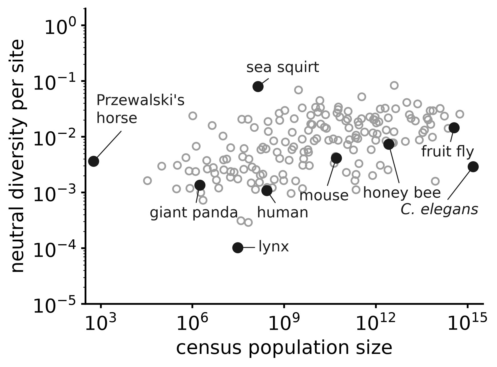
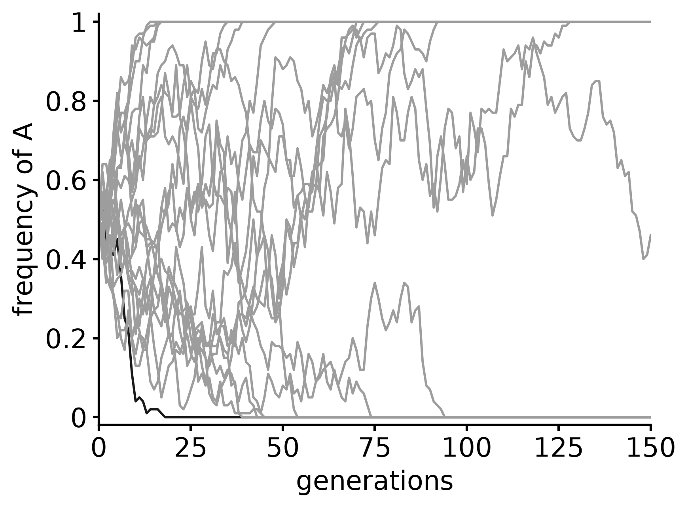
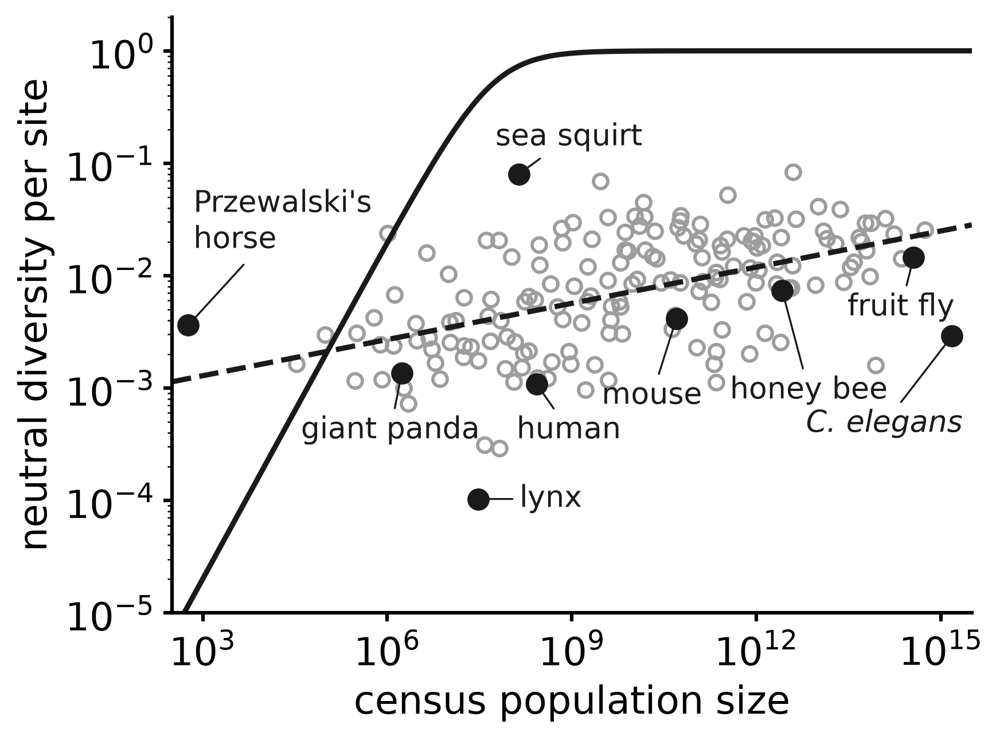
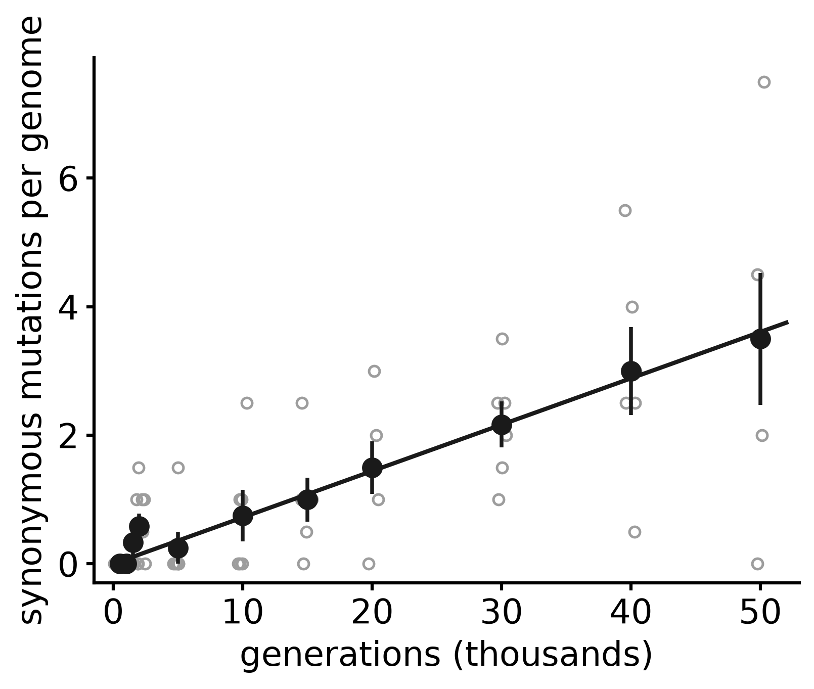
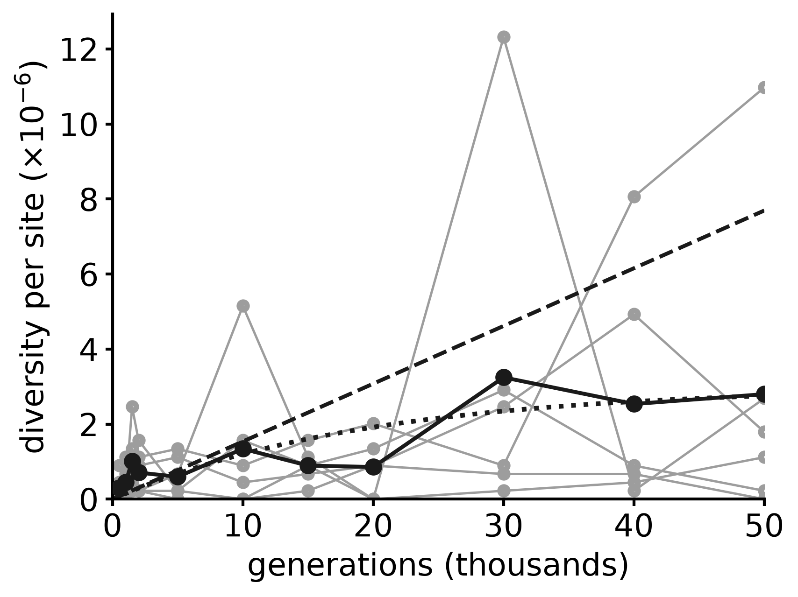

# Lecture 9. Neutral evolution: drift and mutation

---

In [L7](l7.html) selection was deterministic. A fitter type grows in frequency as a logistic, in a population so large that chance plays no role. In [L2](l2.html) randomness was a key ingredient, and a population with $b>d$ could go extinct. Here we put the two together. In a population of finite size, which individuals reproduce is partly a matter of chance, so frequencies change even when all types are equally fit. This is *genetic drift*, one of the mechanisms of [L8](l8.html#mechanisms).

We start from data: how much variation do species have, and how does it depend on how many individuals there are? We follow a population without mutations first, and then add them. Everything in this lecture is *neutral*: no type is fitter than another. Selection comes back in [L10](l10.html).

## How much variation do species have?

The northern and the southern elephant seal are close relatives. Hunting brought the northern one down to a few tens of individuals in the 19th century ([L8](l8.html#mechanisms)). Today there are more than $10^5$ of them, and they carry almost no genetic variation, much less than the southern species ([Hoelzel et al. 1993](https://doi.org/10.1093/oxfordjournals.jhered.a111370)). How much variation does a species carry, and what sets it?

### Heterozygosity

To measure variation, draw two individuals at random (with replacement). The probability that they are of different types is the *heterozygosity*. With $m$ types,

$$
H=1-\sum_{i=1}^m x_i^2 .
$$

With two types, $H=2x(1-x)$. $H=0$ when only one type is present. The maximum, $1-1/m$, is reached when all types are equally frequent, $x_i=1/m$. In a diploid species the two individuals are the two copies of a gene in one individual, and $H$ is the expected fraction of heterozygotes: hence the name.

For DNA sequences we apply this to each site. The probability that two copies of a sequence differ at a given site is the *nucleotide diversity* $\pi$.

A mutation in a gene can be of two kinds. A *synonymous* mutation turns a codon into another one coding for the same amino acid: the protein does not change. A *nonsynonymous* mutation changes the amino acid. A synonymous mutation does not change the protein, so to a first approximation it does not change fitness: it is *neutral*. To measure variation that selection does not touch, we look at sites like these.

### Diversity against population size

[Buffalo 2021](https://doi.org/10.7554/eLife.67509) collected the neutral diversity of 173 animal species, from [Leffler et al. 2012](https://doi.org/10.1371/journal.pbio.1001388) and two other compilations, at synonymous or other sites assumed to be neutral. He estimated their census sizes from the geographic range times the population density predicted from body size. Census sizes go from thousands, for large mammals, to more than $10^{12}$ for small insects: 12 orders of magnitude. Diversity spans only 3, from $10^{-4}$ to 0.08.

> [!figure] Diversity against population size
> Neutral diversity per site against the estimated census size, 173 animal species (Buffalo 2021), with a few of them named. The census sizes are order-of-magnitude estimates from range and body size: humans, for instance, end up at $3\times10^8$.
>
> 

Is this a lot or a little? To say it, we need to know what sets the variation of a population.

## Genetic drift

Take a population of $N$ individuals of two types, $A$ and $a$, with the same fitness. $N$ is constant: the limits to growth of [L4](l4.html) keep the population at its carrying capacity, and we only follow who reproduces. The frequency of $A$ is $x=n/N$. In [L7](l7.html#two-types-growing-exponentially), with $f_A=f_a$, $\dot x=0$ and the frequency does not change. In a finite population it does, because which individuals reproduce is random.

Without noise $H$ does not change: $dH/dt=-2\sum_ix_i\,\dot x_i=0$. What happens to its average when $N$ is finite?

### Moran model

The simplest way to keep $N$ constant is to replace one individual at a time ([Moran 1958](https://doi.org/10.1017/S0305004100033193)). In continuous time, as in [L2](l2.html#what-a-rate-is), each individual reproduces at rate $b$, and its offspring replaces an individual chosen at random. $n$ changes when an $A$ replaces an $a$, or the other way round:
$$
n\to n+1\quad\text{at rate}\quad bN\,x(1-x),\qquad n\to n-1\quad\text{at rate}\quad bN\,x(1-x).
$$

Each individual is replaced at rate $b$, once every $1/b$ on average. We call this time a *generation*. Where $b$ does not appear below, time is measured in generations ($b=1$). It is a birth–death process, as in L2, where the birth of one type is the death of the other.

in a short time $\Delta t$,

$$
\langle x(t+\Delta t)\rangle_x=x .
$$

The mean does not change: on average there is no direction. The variance is the drift, and it vanishes for $N\to\infty$.

For the heterozygosity we need the second moment:

$$
\langle x^2(t+\Delta t)\rangle_x=x^2+\Bigl[\Bigl(x+\tfrac1N\Bigr)^2-x^2+\Bigl(x-\tfrac1N\Bigr)^2-x^2\Bigr]bN\,x(1-x)\,\Delta t=x^2+\frac{2b}N\,x(1-x)\,\Delta t .
$$

So $d\langle H\rangle/dt=-2\,d\langle x^2\rangle/dt=-\frac{2b}N\langle H\rangle$, and

$$
\boxed{\ \langle H(t)\rangle=H(0)\,e^{-2bt/N}\ }
$$

The number of generations in a time $t$ is $bt$, so

$$
\langle H\rangle=H(0)\,\exp\Bigl(-\frac{2\times\text{number of generations}}{N}\Bigr)
$$

The same holds with $m$ types (exercise 1). Two messages:

- **Drift destroys variation.** $\langle H\rangle\to0$: in the end every population has a single type. Which type is random ([L10](l10.html#fixation-of-a-neutral-mutation)).
- **Drift is slow.** $H$ halves in $t_{1/2}=\frac N2\ln2$ generations. A population of $10^6$ individuals with 20-year generations takes $7\times10^6$ years.

> [!figure] Moran populations
> Frequency of $A$ in 20 neutral Moran populations of $N=100$, all starting from $x=1/2$ (one in black). After 150 generations, 12 have fixed $A$, 7 have lost it, 1 still has both types.
>
> 

Without mutations $H\to0$ in every population, more slowly the larger the population. The species in the figure above have $H>0$. What is creating variation?

## Mutation and drift

Drift removes variation and mutation creates it. Where do they balance? Simplest model of mutation for DNA: every mutation creates a new type, never seen before (*infinitely many alleles*, [Kimura & Crow 1964](https://doi.org/10.1093/genetics/49.4.725)). In the Moran model, each offspring mutates with probability $\mu$. 

Define $F$ as the probability that two individuals are of the same type ($F = 1- H$).
In a short time $\Delta t$, with probability $1-2b\Delta t$ neither of the two is replaced, and the pair is as before. With probability $2b\Delta t$ one of them is replaced. The new individual is of the same type if its parent is either the other one, probability $1/N$, or a different individual of the same type as the other one, probability $(1-1/N)\,F$. And, in either of the two, the offspring does not mutate (probability $1-\mu$)

$$
F(t+\Delta t)=(1-2b\Delta t)\,F(t)+2b\Delta t\,(1-\mu)\Bigl[\frac1N+\Bigl(1-\frac1N\Bigr)F(t)\Bigr].
$$

- $1-2b\Delta t$: neither of the two is replaced. Each is replaced at rate $b$; two replacements in the same $\Delta t$ have probability of order $\Delta t^2$.
- $F(t)$: then they are of the same type with the same probability as before.
- $2b\Delta t$: one of the two is replaced.
- $1-\mu$: the newborn did not mutate. A mutant is a new type, different from everyone.
- $1/N$: its parent is the other individual of the pair, so the two are of the same type.
- $(1-1/N)\,F(t)$: its parent is any other individual (possibly the replaced one itself), which is of the same type as the other one with probability $F(t)$.

in continuous limit

$$
\frac{dF}{dt}=2b\Bigl[(1-\mu)\Bigl(\frac1N+\Bigl(1-\frac1N\Bigr)F\Bigr)-F\Bigr]
$$

($F$ is an average over populations, as $\langle H\rangle$ above.) With $\mu=0$, $dF/dt=\frac{2b}N(1-F)$: the decay of $H$ again. For $\mu\ll1$ and $N\gg1$ the fixed point is

$$
F^*\simeq\frac1{1+N\mu},\qquad
\boxed{\ H^*=\frac{\theta}{1+\theta},\qquad \theta=N\mu\ }
$$

$\theta$ is the number of new mutations per generation in the population. In general $N\to N_e$.

- $\theta\ll1$: $H^*\simeq\theta$. Drift wins, and most of the time one type dominates.
- $\theta\gg1$: $H^*\to1$. Mutation wins: many types, all rare.

$F$ approaches $F^*$ at rate $2b(\mu+1/N)$. Reaching the balance takes about $\min(N/2,1/2\mu)$ generations.

For DNA, apply this to each site, with $\mu$ the mutation rate per site and $N$ the number of copies of the sequence in the population. Then $\pi\simeq\theta$, since $\theta\ll1$ at a single site. A diploid species with $N_c$ individuals has $2N_c$ copies, so $\pi\simeq2N_c\mu$. The simulator below has two types mutating into each other, and its balance is a little lower (next paragraph). S2 derives the whole distribution of frequencies at the balance, a Beta distribution.

**Two alleles or infinitely many?** At a site there are four possible bases, and in the data almost always two. With $K$ types, and a mutation that turns the newborn into one of the other $K-1$ types, the equation for $F$ gets one more term: a newborn whose parent is of a different type from the other individual becomes identical to it by mutating into its type, with probability $\mu/(K-1)$. The balance becomes

$$
H^*=\frac{\theta}{1+\frac{K}{K-1}\,\theta},
$$

that is $\theta/(1+2\theta)$ for two types and $\theta/(1+\theta)$ for $K\to\infty$. The difference comes from repeated mutations at the same site: with two types, a second mutation brings the site back. It matters only when $\theta$ is not small; for $\theta\ll1$ every $K$ gives $H^*\simeq\theta$. A small mutation rate is not enough: what must be small is $\theta=N\mu$, the number of mutations per site per generation in the whole population. In the data of [Lewontin's paradox](#lewontins-paradox) $\pi\le0.08$, so the $\theta$ obtained from $\pi$ changes by at most 10%, and by 1% for the median species. The prediction from the census size is in the other regime: for four species out of five $2N_c\mu>1$, and the prediction saturates at $1/2$ with two types ($3/4$ with four bases) instead of 1. For the median species it is still 40 times the observed diversity, instead of 75.

> [!figure] Drift simulator
> Many populations at once. Choose $N$, the mutation probability $\mu$ and the starting frequency $x_0$. Follow 20 of the populations, the histogram of all of them now, the mean heterozygosity against the theory of this lecture, and the fraction of populations where $A$ is fixed or lost. *Drift*: $H$ decays and the populations end at $x=0$ or $x=1$. *Mutation–drift*: $H$ levels off where mutation balances drift. The slider $s$ and the other examples are for L10. The toggle switches from the Moran model to Wright–Fisher ([additional material](#additional-material.-the-wrightfisher-model)).
>
> <iframe class="widget" src="material/l9-drift-simulator.html" title="L9-drift-simulator" loading="lazy" style="display:block;width:100%;height:520px;border:0;margin:.6rem 0"></iframe>

## Lewontin's paradox

We can now compare with the data. Mutation rates per site per generation are $10^{-9}$ to $10^{-8}$ in animals. If the $N$ in $\theta$ were the census size $N_c$, $\pi$ would range from $10^{-5}$ to almost 1.

> [!figure] Lewontin's paradox
> Neutral diversity per site against the estimated census size, 173 animal species (Buffalo 2021). Solid line: neutral prediction $\theta/(1+\theta)$ with $\theta=2N_c\mu$, $\mu=10^{-8}$. Dashed line: least-squares fit, $\pi\propto N_c^{0.11}$.
>
> 

Diversity grows with census size, but as $N_c^{0.1}$, not as $N_c$: a species a billion times more abundant is only about ten times more diverse. This is *Lewontin's paradox* (R. C. Lewontin, *The Genetic Basis of Evolutionary Change*, 1974; he saw it in protein variation).

## Why is diversity so low?

Three main explanations have been proposed. There is not an agreement

### Effective population size

The $N$ in $\theta$ need not be the number of individuals today. What sets the speed of drift is how unequal their reproduction is. In the Moran model the variance of the frequency is given by
$$
\operatorname{var}\bigl(x(t+\Delta t)\bigr)_x=\frac{2b}N\,x(1-x)\,\Delta t .
$$
if $N$ is time dependent, we obtain 
$$
\operatorname{var}\bigl(x(t+\Delta t)\bigr)_x=\frac{2b}{N(t)}\,x(1-x)\,\Delta t .
$$
from which
$$\frac{d\langle H\rangle}{dt}=-\frac{2b}{N(t)}\langle H\rangle$$
which leads to
$$
\langle H(t)\rangle=H(0)\exp\Bigl(-2\int_0^t\frac{d\tau}{N(\tau)}\Bigr) .
$$
we can introduce an effective population size $N_e$, defined as
$$
\qquad \frac1{N_e}=\frac1t\int_0^t\frac{d\tau}{N(\tau)}
$$
so then
 $$\langle H(t)\rangle = H(0) e^{-2t/N_e}$$.

$N_e$ is the harmonic mean of $N(\tau)$, dominated by the smallest values. A population of 10 individuals 10% of the time, and 1000 otherwise, has an arithmetic mean of 901 and $N_e\simeq92$. Bottlenecks set $N_e$.

The effective population size is reduced also if different individuals have large variance in the number of offspring. In many marine species most of the offspring of a generation come from a few parents, so the variance of offspring number is large. Population structure also matters.

The northern elephant seal is an extreme case. Hunting left an estimated bottleneck of fewer than 30 individuals in the 19th century. There are now well over $10^5$, with almost no genetic variation ([Hoelzel et al. 1993](https://doi.org/10.1093/oxfordjournals.jhered.a111370)).

In natural populations $N_e$ is usually smaller than the census size, by about an order of magnitude on average in [Frankham 1995](https://doi.org/10.1017/S0016672300034455)'s review. 
However, Lewontin's paradox asks for much more: for the most abundant species $N_e$ would have to be about $10^7$ times smaller than the census population size.
Note that models alternative to Moran would lead to different definitions of $N_e$. For instance, in the Wright–Fisher model $N_e$ is half of ours (see the [additional material](#additional-material.-the-wrightfisher-model)). However such differences are order $1$ and the scaling of heterozygosity is very robust (see [the diffusion approximation](#additional-material.-the-diffusion-approximation)), so not enough to explain the paradox.

### Time

The balance between mutation and drift takes $\min(N/2,1/2\mu)$ generations to reach. Populations that grew recently, for instance after the last glaciation, are not there yet.

### Selection at linked sites

A neutral site does not evolve on its own: it sits on a genome, together with sites where a mutation changes fitness. Take two kinds of genome, one fitter than the other and spreading. A neutral mutation that appears on a copy of the fitter kind does nothing by itself, but it rises with the genome that carries it: it *hitchhikes*. The diversity at neutral sites is shaped by selection at the sites they are linked to.

A beneficial mutation that sweeps to fixation ([L7](l7.html#two-types-growing-exponentially)) carries along the variants on its genome and erases diversity around it ([Maynard Smith & Haigh 1974](https://doi.org/10.1017/S0016672300014634)). The removal of deleterious mutations does the same. Both are stronger in large populations, where selection is more effective ([Gillespie 2001](https://doi.org/10.1111/j.0014-3820.2001.tb00732.x)). Buffalo's estimate is that they are not enough. The LTEE shows linked selection at work ([below](#diversity-in-the-ltee)).

## Long-term evolution experiment

Can we watch one of these explanations at work? Selection at linked sites is strongest when the genome does not recombine and is inherited as one block, as in bacteria.

The LTEE ([L8](l8.html#evolution-we-can-watch)) has run since 1988. Twelve populations of *E. coli* are diluted 100-fold into fresh medium every day, about 6.6 generations per day. [Tenaillon et al. 2016](https://doi.org/10.1038/nature18959) sequenced the whole genome of two clones from each population at 11 times between 500 and 50,000 generations, and listed every mutation relative to the ancestor. In six populations a mutation in DNA repair raised the mutation rate. We look at the other six. We first ask what a single genome carries, and then compare two genomes of the same population.

**What the data show.** The number of synonymous mutations in a genome grows linearly with time, about 3.5 after 50,000 generations. (Nonsynonymous mutations behave very differently: they are the subject of L10.)

> [!figure] Synonymous mutations in the LTEE
> Synonymous mutations per genome against generations, in the six populations that kept the ancestral mutation rate: each population (grey, mean of its two clones), mean over the six ± SEM (black). The line goes through the origin with slope $7.2\times10^{-5}$ per generation (least squares). Data: Tenaillon et al. 2016, curated counts of the Barrick lab.
>
> 

Why do neutral mutations accumulate at a constant rate, and what sets the rate? Follow the ancestors of a genome back in time. Neutral mutations appear along this line of descent at rate $\mu$ per generation, whatever happens to the rest of the population. The slope is the mutation rate.

**The slope and the mutation rate.** The slope is $7.2\times10^{-5}$ synonymous mutations per genome per generation. To turn it into a rate per site, we need the number of sites at which a point mutation is synonymous. The genome has $L=4.6\times10^6$ base pairs. About 88% of it codes for proteins, and about a quarter of the point mutations in a coding sequence leave the amino acid unchanged, mostly at the third position of a codon. So about one point mutation in five is synonymous, $f_s\approx0.2$ (the fraction measured in mutation-accumulation lines of the same strain is 0.20, 40 of 199; Tenaillon et al. 2016). The rate of point mutations per genome and per site is then

$$
U=\frac{7.2\times10^{-5}}{f_s}\approx3.6\times10^{-4}\ \text{per genome per generation}$$
and then
$$ \mu=\frac{U}{L}=\frac{3.6\times10^{-4}}{4.6\times10^{6}}\approx7.7\times10^{-11}\ \text{per site per generation}.
$$

A genome gains a new point mutation about once every 3,000 generations. [Wielgoss et al. 2011](https://doi.org/10.1534/g3.111.000406) found $8.9\times10^{-11}$ per site from 19 LTEE genomes.

## Diversity in the LTEE

How much variation does a population of the LTEE hold, and what does the theory of this lecture predict? Tenaillon et al. sequenced two clones from each population at each time. The probability that two genomes differ at a site, the diversity per site, is the number of point mutations found in one clone and not in the other, divided by the number of sites that can be read ($4.5\times10^6$).

**The prediction.** Each population starts from a single clone: $F(0)=1$, $H(0)=0$. The equation for $F$ of [Mutation and drift](#mutation-and-drift) is linear, and from this start its solution is

$$
H(t)=1-F(t)=\bigl(1-F^*\bigr)\bigl(1-e^{-\lambda t}\bigr)$$
where
$$ \lambda=2b\Bigl[1-(1-\mu)\Bigl(1-\frac1N\Bigr)\Bigr]\simeq2b\Bigl(\mu+\frac1N\Bigr),\qquad F^*=\frac{2b(1-\mu)}{N\lambda} .
$$

It needs three numbers. $b$ is one per generation. $\mu$ is the rate of point mutations per site: $7.7\times10^{-11}$ from the synonymous clock. $N$ is the effective population size of the LTEE.

**The effective population size of the LTEE.** Drift in the LTEE happens mostly at the daily dilution: $N_0=5\times10^6$ cells are sampled out of $5\times10^8$, which adds a variance $x(1-x)/N_0$ once a day, every $g\approx6.6$ generations. Comparing with the variance per generation of the Moran model, $2x(1-x)/N_e$, gives

$$
N_e\approx2N_0\,g\approx7\times10^7 ,
$$

the effective size set by drift alone. With this $N$, $\lambda t\ll1$ for the whole experiment and $H(t)\simeq2b\mu t$: diversity should grow linearly, to $7.7\times10^{-6}$ at 50,000 generations with the clock's $\mu$. The observed diversity is $2.8\times10^{-6}$ at 50,000 generations, and it barely grows after 30,000.

> [!figure] Diversity in the LTEE
> Diversity per site between the two clones sampled at the same time from the same population (point mutations in one clone and not in the other, per readable site): each of the six populations that kept the ancestral mutation rate (grey) and their mean (black). Lines: the equation for $F$ solved from $F(0)=1$, with $b=1$ per generation and $\mu=7.7\times10^{-11}$ per site, for $N=N_e=7\times10^7$ (dashed) and for the $N$ that fits the mean, $3.9\times10^4$ (dotted). Each point is one pair of clones, so single populations are noisy; read the mean. Data: Tenaillon et al. 2016, curated mutation lists of the Barrick lab.
>
> 

**The effective population size seen by diversity.** If instead we fit $N$ to the observed diversity, with $\mu$ from the clock, we get $N\approx4\times10^4$. With this $N$ the equation saturates at $H^*\simeq N\mu\approx3\times10^{-6}$, on a time scale $N/2\approx2\times10^4$ generations, as the data do. The diversity behaves as if the population were 2,000 times smaller than its drift $N_e$, and $10^4$ times smaller than the number of cells. 

This is the same [Lewontin's paradox](#lewontins-paradox). The clock gives $\mu$, the diversity gives $N\mu$, and together they give an $N$ far below the size of the population. Here we know why. Beneficial mutations sweep, and in a population that does not recombine each sweep carries along a whole genome, so the population keeps descending from a recent ancestor: [selection at linked sites](#selection-at-linked-sites). The same sweeps carry the synonymous mutations along, and leave the rate at which they accumulate unchanged: along a line of descent they appear at rate $\mu$, whatever the sweeps do ([above](#long-term-evolution-experiment)).

## Additional material. The diffusion approximation

All the results so far come from exact equations for the Moran model. For large $N$, $x$ changes in small steps of $1/N$, and the master equation can be replaced by a partial differential equation for the probability density $P(x,t)$ of the frequency, the *Fokker–Planck equation*:

$$
\frac{\partial P}{\partial t}=-\frac{\partial}{\partial x}\bigl[A(x)\,P\bigr]+\frac12\,\frac{\partial^2}{\partial x^2}\bigl[B(x)\,P\bigr],\qquad B(x)=\frac{2\,x(1-x)}{N} .
$$

$B$ is drift. $A$ is what pushes the frequency deterministically: zero for pure drift, $v-(u+v)x$ with two alleles mutating into each other at rates $u$ and $v$, and selection in L10. The derivation, the boundaries, the stationary distribution with mutation and the times to fixation are in S2.

## Additional material. The Wright–Fisher model

Population genetics was built on a different model, where generations do not overlap: all individuals reproduce at the same time, and then die. Each of the $N$ individuals of the next generation picks its parent at random in the current one ([Wright 1931](https://doi.org/10.1093/genetics/16.2.97)). The number of $A$ in the next generation is binomial,

$$
P(n'\mid n)=\binom{N}{n'}\,x^{n'}(1-x)^{N-n'},\qquad x=\frac nN ,
$$

and multinomial with $m$ types. For the frequency $x'=n'/N$,

$$
\langle x'\rangle_x=x,\qquad \operatorname{var}(x')_x=\frac{x(1-x)}{N}.
$$

For the heterozygosity, $\langle x'^2\rangle_x=x^2+x(1-x)/N$, so

$$
\langle H(t+1)\rangle_{x(t)}=2\langle x'\rangle_x-2\langle x'^2\rangle_x=\Bigl(1-\frac1N\Bigr)\,2x(1-x)=\Bigl(1-\frac1N\Bigr)H(t),
$$

and $\langle H(t)\rangle=(1-1/N)^t H(0)\simeq H(0)\,e^{-t/N}$. Per generation, drift is half as fast as in the Moran model. The difference is in the variance of the number of offspring: about 1 here, 2 in the Moran model (exercise 2).

**Fixation.** The mean frequency does not change, so a neutral type fixes with probability $n/N$, as in the Moran model. A neutral mutant that fixes takes about $2N$ generations.

**Mutation.** The argument for $F$ is the same, in discrete time: $F(t+1)=(1-\mu)^2\bigl[\frac1N+(1-\frac1N)F(t)\bigr]$. The fixed point is $F^*\simeq1/(1+2N\mu)$, so $\theta=2N\mu$.

| | Moran | Wright–Fisher |
| --- | --- | --- |
| variance of the number of offspring | 2 | 1 |
| $\langle H\rangle$ decays as | $e^{-2t/N}$ | $e^{-t/N}$ |
| time to fixation of a neutral mutant | $N$ | $2N$ |
| $\theta$ | $N\mu$ | $2N\mu$ |

**Reading the literature.** Population genetics defines $N_e$ against Wright–Fisher, $N_e=N/\sigma^2$, half of the $N_e$ of this lecture. So in papers and textbooks, for a diploid species, you find $\langle H\rangle\propto e^{-t/2N_e}$, $\pi=4N_e\mu$, and a time $4N_e$ to fix a neutral mutation. In these units the LTEE has $N_e\approx N_0\,g\approx3\times10^7$.

## Exercises

1. Moran with $m$ types. Show that each $n_i$ goes up and down by one at rate $N\,x_i(1-x_i)$, and that $d\langle H\rangle/dt=-\frac2N\langle H\rangle$ with $H=1-\sum_ix_i^2$.
2. Offspring number. (a) In the Moran model each individual is replaced at rate 1 and reproduces at rate 1. Show that the number of offspring it has before being replaced is geometric, $P(k)=2^{-(k+1)}$, with mean 1 and variance 2. (b) In Wright–Fisher (additional material), show that it is binomial with mean 1 and variance $1-1/N$. Relate this to the factor 2 between the two decays of $H$.
3. Effective size. A population alternates between $N_1$ and $N_2$ individuals, one generation each. Find $N_e$ for $N_1=10$, $N_2=10^4$, and compare it with the arithmetic mean.
4. Mutation and drift. (a) Derive the equation for $F$ and its fixed point. (b) A haploid population has $N=10^9$ and $\mu=10^{-8}$ per site. Compute $H^*$, and how many generations it takes to approach it.
5. Data in the course folder: the mutations of the LTEE clones (Tenaillon et al. 2016) and of 15 mutation-accumulation lines of the same strain, kept for 13,750 generations. (a) For each of the six populations, fit the slope of synonymous mutations against generations. Are the differences compatible with Poisson noise? (b) In the mutation-accumulation lines, what fraction of point mutations is synonymous? Use it, with the genome size $4.63\times10^6$ bp, to turn the LTEE slope into a mutation rate per base pair. (c) Compute the same rate directly from the mutation-accumulation lines (all point mutations, per line, per generation, per base pair). The two differ by a factor of about 3. Propose explanations, using what you know about $N_e$ in the two experiments.
6. Data in the course folder: the diversity and census sizes of Buffalo 2021. Assume $\mu=10^{-8}$ per site and a diploid species, and invert $\pi=\theta/(1+\theta)$, $\theta=2N_e\mu$, to get $N_e$ for each species. Plot $N_e/N_c$ against $N_c$. By how much should $N_e$ be smaller than $N_c$ to explain the data?

## At home

- J. H. Gillespie, *Population Genetics: A Concise Guide* (Johns Hopkins University Press, 2nd ed. 2004), ch. 2–3: drift, mutation and the neutral theory, with the same calculations.
- M. A. Nowak, *Evolutionary Dynamics* (2006), ch. 6: the Moran process and fixation probabilities.
- [Blythe & McKane 2007](https://doi.org/10.1088/1742-5468/2007/07/P07018): stochastic models of evolution, written for physicists. Also for S2.
- [Charlesworth 2009](https://doi.org/10.1038/nrg2526): what effective population size is, and what it does to molecular evolution.
- [Kern & Hahn 2018](https://doi.org/10.1093/molbev/msy092): the neutral theory fifty years later.

## References

- S. Wright, [Evolution in Mendelian populations](https://doi.org/10.1093/genetics/16.2.97), *Genetics* **16**, 97 (1931).
- P. A. P. Moran, [Random processes in genetics](https://doi.org/10.1017/S0305004100033193), *Math. Proc. Camb. Philos. Soc.* **54**, 60 (1958).
- M. Kimura, J. F. Crow, [The number of alleles that can be maintained in a finite population](https://doi.org/10.1093/genetics/49.4.725), *Genetics* **49**, 725 (1964).
- E. Zuckerkandl, L. Pauling, [Evolutionary divergence and convergence in proteins](https://doi.org/10.1016/B978-1-4832-2734-4.50017-6), in *Evolving Genes and Proteins*, V. Bryson, H. J. Vogel eds. (Academic Press, 1965), p. 97.
- M. Kimura, [Evolutionary rate at the molecular level](https://doi.org/10.1038/217624a0), *Nature* **217**, 624 (1968).
- J. L. King, T. H. Jukes, [Non-Darwinian evolution](https://doi.org/10.1126/science.164.3881.788), *Science* **164**, 788 (1969).
- R. E. Dickerson, [The structure of cytochrome c and the rates of molecular evolution](https://doi.org/10.1007/BF01659392), *J. Mol. Evol.* **1**, 26 (1971).
- J. Maynard Smith, J. Haigh, [The hitch-hiking effect of a favourable gene](https://doi.org/10.1017/S0016672300014634), *Genet. Res.* **23**, 23 (1974).
- R. C. Lewontin, *The Genetic Basis of Evolutionary Change* (Columbia University Press, 1974).
- C. W. Birky, J. B. Walsh, [Effects of linkage on rates of molecular evolution](https://doi.org/10.1073/pnas.85.17.6414), *PNAS* **85**, 6414 (1988).
- A. R. Hoelzel et al., [Elephant seal genetic variation and the use of simulation models to investigate historical population bottlenecks](https://doi.org/10.1093/oxfordjournals.jhered.a111370), *J. Hered.* **84**, 443 (1993).
- R. Frankham, [Effective population size/adult population size ratios in wildlife: a review](https://doi.org/10.1017/S0016672300034455), *Genet. Res.* **66**, 95 (1995).
- J. H. Gillespie, [Is the population size of a species relevant to its evolution?](https://doi.org/10.1111/j.0014-3820.2001.tb00732.x), *Evolution* **55**, 2161 (2001).
- R. A. Blythe, A. J. McKane, [Stochastic models of evolution in genetics, ecology and linguistics](https://doi.org/10.1088/1742-5468/2007/07/P07018), *J. Stat. Mech.* P07018 (2007).
- B. Charlesworth, [Effective population size and patterns of molecular evolution and variation](https://doi.org/10.1038/nrg2526), *Nat. Rev. Genet.* **10**, 195 (2009).
- S. Wielgoss, J. E. Barrick, O. Tenaillon et al., [Mutation rate inferred from synonymous substitutions in a long-term evolution experiment with *Escherichia coli*](https://doi.org/10.1534/g3.111.000406), *G3* **1**, 183 (2011).
- J. J. Leffler et al., [Revisiting an old riddle: what determines genetic diversity levels within species?](https://doi.org/10.1371/journal.pbio.1001388), *PLoS Biol.* **10**, e1001388 (2012).
- O. Tenaillon, J. E. Barrick, N. Ribeck et al., [Tempo and mode of genome evolution in a 50,000-generation experiment](https://doi.org/10.1038/nature18959), *Nature* **536**, 165 (2016); curated counts: [barricklab/LTEE-Ecoli](https://github.com/barricklab/LTEE-Ecoli) (CC0).
- A. D. Kern, M. W. Hahn, [The neutral theory in light of natural selection](https://doi.org/10.1093/molbev/msy092), *Mol. Biol. Evol.* **35**, 1366 (2018).
- V. Buffalo, [Quantifying the relationship between genetic diversity and population size suggests natural selection cannot explain Lewontin's paradox](https://doi.org/10.7554/eLife.67509), *eLife* **10**, e67509 (2021); data: [vsbuffalo/paradox_variation](https://github.com/vsbuffalo/paradox_variation).
